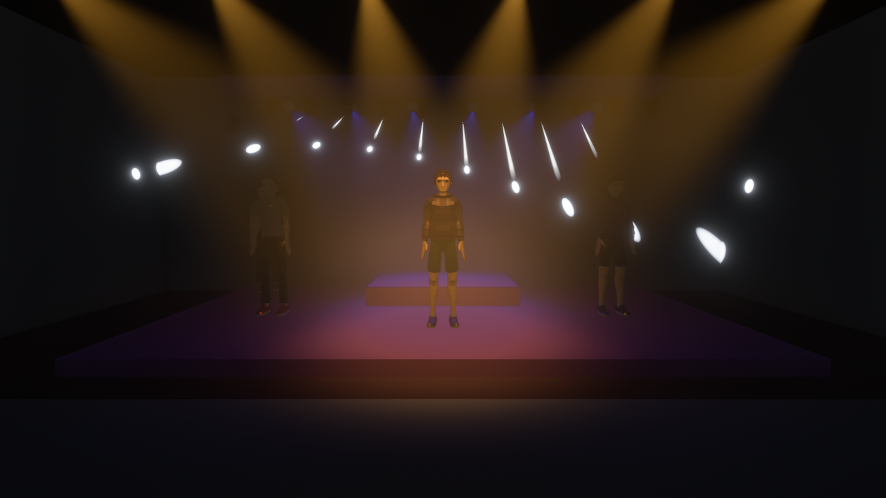
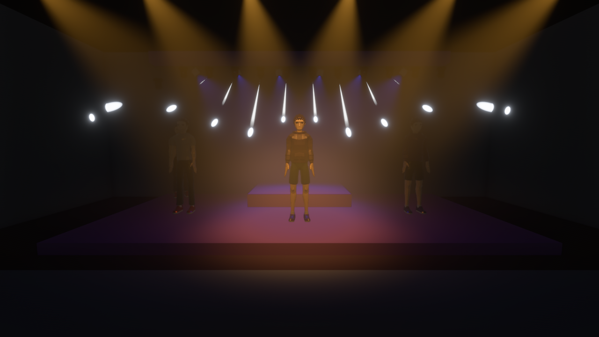
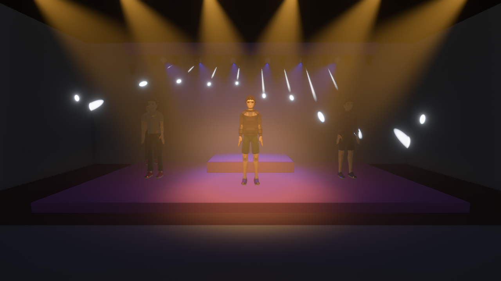
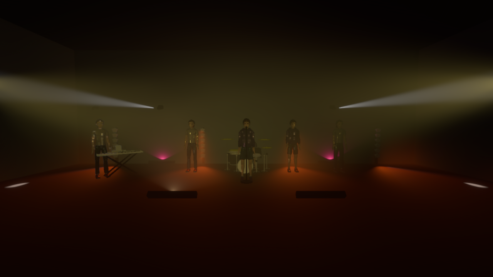
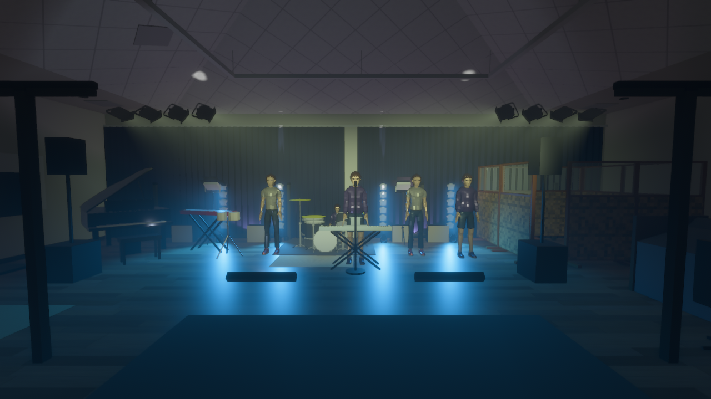
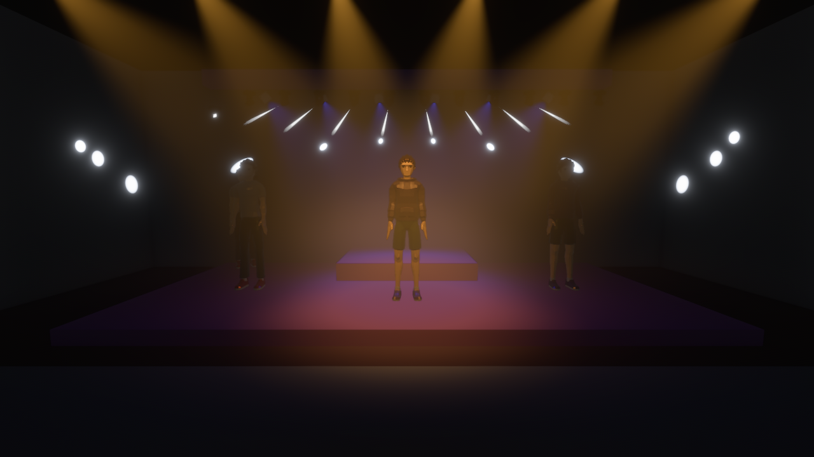
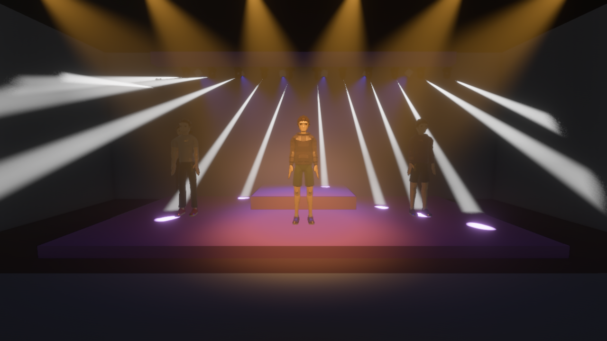
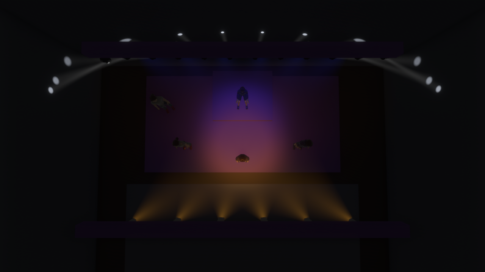

# Programming a show: what there is, where it lives, what edits it

One page for a person or an agent about to change lighting: every thing in
the model, the file it is in, the action that edits it, and how a cue file
becomes a lit fixture. Each action's arguments are in
[actions.md](actions.md) (generated from the catalogue). For grandMA3
users, the right-hand column of the first table and the two mapping tables
further down say which Ignition word is which MA word.

Everything here is driven the same four ways: the app's command palette,
its CLI (`studio actions run IGNITION_… --json '{…}'`), MCP (`studio mcp`)
and Luau (`actions.run("IGNITION_…", {…})`, `state.query(…)` for the
read-only ones, through `SCRIPT_RUN`). With no app running,
`ignition-program IGNITION_… '{…}'` runs the same code from a shell.

## The model

| Thing | What it is | Where it is stored | Edited by | grandMA3 |
|---|---|---|---|---|
| **Environment** | A room: floor, walls, audience area; props (truss, risers); screens; cameras | `data/venues/<env>/` (`room.json`, `props.json`, `screens.json`, `cameras.json`, `venue.ig-venue`) | `IGNITION_ENV_*` | Stage, 3D objects |
| **Measured room** | A room built from a scan: one model whose objects (architecture, furniture, gear) are named, placed, shown or hidden, plus the room's own lights in switchable groups. Drawn instead of the boxes when the model is on the machine | `<env>/environment.json` (the model itself is not in the repo: `IGNITION_ENVIRONMENT_DIR` or `<env>/model/`). Only the lab, `room138-cbu`, has one: see [lab-138-room.md](../lab-138-room.md) | `IGNITION_ENV_GET` (its dimensions, objects, light groups), `IGNITION_ENV_PIECE_SET {in: "environment"}` (move, turn, show, hide an object), `IGNITION_ENV_LIGHTS` (house lights) | Stage with imported 3D objects |
| **People** | Performers and stand-ins: position, facing, height, label | `<env>/people.json`; each is also a prop (drawn) and a focus point at head height (aimed at) | `IGNITION_PERSON_SET/REMOVE`, `IGNITION_PEOPLE_LIST` | MArker fixtures |
| **Blocking** | Where people stand per song and per section | `<env>/blocking.json` | `IGNITION_BLOCKING_SET` | (none) |
| **Fixture** | One light: type, mode, where it hangs, how it is turned, tags | `<env>/fixtures.json` (one record per channel) | `IGNITION_FIXTURE_ADD/SET/REMOVE/LIST` | Patch: fixture, 3D position |
| **Fixture type** | A model: its modes (channel charts), optics, size | `data/fixtures/*.json`, profiles in `data/gdtf/` | `IGNITION_FIXTURE_TYPES` reads; adding a type is still a file | Fixture type |
| **Patch** | Universe and address per fixture; where each universe goes on the wire | `fixtures.json` (`universe`, `address`), `venue.ig-venue` (`dmx.universes`: sACN, Art-Net) | `IGNITION_PATCH_GET/SET/PACK/ROUTE` | Patch, DMX universes, output config |
| **Group** | A named, ordered list of channels | `<env>/groups.json` | `IGNITION_GROUP_SET/LIST` | Group |
| **Role** | A job a rig plays (`Key`, `Wash`, `Back`, `Movers`…): what a show names instead of fixtures | Declared in the profile; bound per room in `<env>/profile.json` | `IGNITION_ROLE_BIND` | (none: a show there names fixtures) |
| **Focus point** | A named point in the room, metres (a position palette entry) | `<env>/palettes.json` `focus`; a set's own in the library `focus` | `IGNITION_FOCUS_SET`, `IGNITION_FOCUS_ON`, library actions | Position preset, MArker |
| **Colour** | Linear RGB by name | Profile `colors` (28 shipped); a set's own in the library `colors` | library actions | Colour preset (universal) |
| **Palette** | Named **slots** (`Primary`, `Secondary`, `Accent`, `White`…), each a colour. Cues name slots; the palette in use decides what they are | Library `palettes`; in use: the set's `palette`, or a song's | library actions, `IGNITION_PALETTE_USE`, `IGNITION_SONG_SLOTS` | A page of colour presets you swap |
| **Split** | Several colours across a selection (cycle, spread, block) | Profile `splits`; library `splits` | library actions | Multi-colour preset |
| **Beam preset** | Zoom, iris, focus, gobo slot set together | Library `beams` | library actions | Beam / Gobo preset |
| **Effect** | A recipe of two or more steps with a rate, a measure and a spread | Profile `effects` (139 shipped, in seven families); library `effects` | library actions, `IGNITION_EFFECT_MAKE`, `IGNITION_EFFECT_PREVIEW` | **Phaser** |
| **Look** | A static scene against roles | Profile `looks`; library `looks` | library actions | Preset (All) / a cue stored as a look |
| **Tricks** | How a selection is cut into units and how a value spreads across them | On a recipe (`tricks`, `timing`); named presets in the profile `tricks` and the library `tricks` | library actions, `IGNITION_TRICKS_UNITS`, `IGNITION_TRICKS_APPLY` | **MAtricks**, Selection Grid |
| **Cue** | A named state at a position: parts (recipes), fade, block | A song's file, `cues` | `IGNITION_CUE_*`, `IGNITION_SECTION_*`, `IGNITION_FILL_SECTIONS` | Cue (its parts are recipe lines) |
| **Trigger** | A one-shot the song fires at a position (a hit, an accent) | A song's file, `triggers` | `IGNITION_FILL_HITS`, `IGNITION_TRIGGER_LIST/CLEAR` | Timecode event on a temp/flash key |
| **Section map** | A song's sections: name, first bar, length | A song's file, `sections` | `IGNITION_SONG_MAP_SET`, `IGNITION_SONG_MAP_IMPORT` (from the Live set) | Timecode markers |
| **Markers** | Named points in a song: kick, snare, a stop | A song's file, `markers` | `IGNITION_SONG_MAP_SET` | Timecode markers |
| **Song** | One song's show: cues, triggers, section map, markers, its library overrides | `data/songs/<set>/<song>.json` (in a vault: `Projects/<Set>/lighting/cues/`) | `IGNITION_SONG_*` | Sequence |
| **Set (show)** | The night: profile, environment, songs in order, the set's library | `data/shows/<set>.ig-show`, `data/library/<set>.json` | `IGNITION_SONG_LIST/CREATE`, `IGNITION_SET_EACH`, `IGNITION_SET_CHECK`, `IGNITION_ENV_USE` | Show file |

What still has no action (edit the file): cameras (`cameras.json`), a new
fixture type (`data/fixtures/*.json` then `tools/make_gdtf.py`), the
profile itself (its roles, its shipped effects: duplicate an entry into the
library to change it), the operator's fader pages and macros, and deleting
an environment.

## From a cue file to a lit fixture

```
 .ig-show ──► songs/<song>.json ──► cue ──► part (recipe) ──► selection ──► units ──► values ──► DMX
   │              │                           │                 │            │          │
   │              └ library overrides          │                 │            │          └ patch: universe.address per attribute,
   └ library/<set>.json                        │                 │            │            then venue.ig-venue: sACN / Art-Net
     profile (colours, effects, looks)         │                 │            └ per unit: colour → RGB (slot → palette → colour),
     venue (the environment)                   │                 │              focus point → pan/tilt from where the fixture hangs
                                               │                 └ tricks cut the fixtures into units; phase, speed spread over them
                                               └ a Role ("Wash") → the room's binding → a group → channels, in order
```

1. **The show** names a profile, an environment and the songs. The renderer
   (`ignition`) follows a clock (Studio's playback, a session's transport,
   MIDI) to a song and a bar.
2. **The song's cue list** is asked "what is the state at bar 43", never
   "fire cue 9": cues track forward, so a seek lands right.
3. **A cue is its parts.** A part is a recipe: a target, steps, timing,
   tricks. One step is a static part (level, colour, focus); two or more is
   an effect. A part may name a library effect (`{"effect": "chase"}`), a
   bundle or a look instead of spelling it out.
4. **The target is a selection**, normally a role. The room's
   `profile.json` says which fixtures play it, so the same song runs in any
   room that binds the roles.
5. **Names are looked up when the cue is taken**, in three layers, later
   over earlier: the profile, the set's library, the song's overrides. A
   colour name that is a slot of the palette in use is that palette's
   colour.
6. **Values per fixture, per frame**: colours solved against each
   fixture's emitters, a focus point turned into pan and tilt from the
   fixture's position and hang, relative effect values added on the look.
7. **The patch** turns attributes into bytes at each fixture's universe and
   address; `venue.ig-venue` says where each universe goes.

The renderer reads the song's file and the set's library again when either
changes (it looks twice a second), so a cue, palette or effect edited by an
action shows in the room without restarting anything. The environment
(geometry, fixtures, patch, people) is read when the renderer starts: see
"What is left".

## How a cue is timed

A position (`at`) is stored as the author meant it and resolved to a bar
against the song's section map:

| You write | It means |
|---|---|
| `12` or `"12.3"` | bar 12; bar 12 beat 3 |
| `"Chorus 1"` | the first bar of that section |
| `"Chorus 1+2"` | two bars into it |
| `"Chorus#2"` | the second section of that name |
| `{"marker": "stop"}` | where that marker is |
| `{"section": "Bridge", "last_bar": true}` | the section's last bar |

A cue placed by section moves with the section when the arrangement
changes (`IGNITION_SONG_MAP_IMPORT` re-reads the Live set and resolves every
cue again). `resolved` in the file is the bar it came to, for a player with
no map.

## The library, its layers, and re-skinning

`IGNITION_LIBRARY_LIST/GET/CREATE/UPDATE/DUPLICATE/DELETE` work on eight
kinds: `colors`, `palettes`, `splits`, `effects`, `looks`, `focus`, `beams`,
`tricks`. Every entry takes `about`, `tags` and `folder`; `LIST` filters by
them and says which layer each entry comes from.

- **Profile** (read-only): what ships. `IGNITION_LIBRARY_DUPLICATE` copies an
  entry out of it to change.
- **Set** (`scope: "set"`, the default): `data/library/<set>.json`, shared
  by every song of the set. The `.ig-show` names it (`library`).
- **Song** (`scope: "song"`): `library` in the song's file. Updating an
  entry with `scope: "song"` copies it up from the set first: that is the
  override.

**Re-skinning** is naming another palette: `IGNITION_PALETTE_USE {palette}`
for the set, with `song` for one song,
`IGNITION_SET_EACH {action: "IGNITION_PALETTE_USE", args: {palette}}` for
every song at once. A slot the new palette lacks stands in from one it has
(`Accent 2` takes `Accent`, anything else `Primary`), so a palette of five
slots skins a song written against seven.

## Effects (grandMA3: Phasers)

An effect is a recipe with two or more steps; there is no separate effect
type. `IGNITION_EFFECT_MAKE` writes one from parameters, and
`IGNITION_EFFECT_PREVIEW` runs any effect on any selection of an
environment and answers each fixture's values over the loop, saving
nothing.

| grandMA3 Phaser | Ignition | In `IGNITION_EFFECT_MAKE` |
|---|---|---|
| Step (a value per step) | A step's `apply` | from `what` + `shape`, or `colors` |
| Absolute / Relative layer | `Raw`/`Color`/`Dimmer` set; `Delta` adds to the look | `base` given: absolute; else relative |
| Width | Step `width` | (edit the entry) |
| Transition | Step `transition` (0 snap, 1 full) | `shape`: square snaps, sine and triangle glide |
| Accel / Decel | Step `ease` (`Linear`, `Sine`, `Curve{accel, decel}`) | from `shape` |
| Speed (Hz, BPM, a speed master) | `timing.speed` (`Hz`, `Bpm`, `Secs`, `Master: "Song"` the tempo map, `"Tap"`) | `speed` |
| Measure | `timing.measure`: beats per loop | `beats` |
| Phase (from–to across the selection) | `timing.phase_offset_deg` + `phase_spread_deg` (and `_y`, `_z` per grid axis) | `spread_deg`, or `tricks` |
| Speed from–to | `timing.speed_from`, `speed_to` | `tricks: {speed: {from, to}}` |
| Direction `<`, `>`, bounce | `timing.direction`: `Forward`, `Reverse`, `Bounce`, `Build`, `Negative` | `direction` |
| A phaser run once (a bump) | `timing.once` | `once` |
| Circle = pan and tilt sines 90° apart | the same two steps | `what: "circle"` |
| Size and Speed masters | `Show.size`, `Show.speed_scale` on the desk | (the operator's, not the file's) |

## Tricks (grandMA3: MAtricks and the Selection Grid)

Tricks shape how a selection is stepped through and how a value spreads
across it. They are data on a recipe, usable by an effect or a static part,
and a **trick preset** is a named set of them in the library (MA: a
MAtricks pool object). `IGNITION_TRICKS_UNITS` shows what any settings do to
any selection: the units, each unit's place on the grid, its phase, rate,
delay and fade.

A preset is `{tricks: […], phase: {from, to}, phase_y, phase_z, speed:
{from, to}, delay: {from, to}, fade: {from, to}, direction, grid}`.

| grandMA3 | Ignition | Notes |
|---|---|---|
| **Block** N | `{"Block": N}` | N neighbours act as one unit |
| **Group** N (the manual: "alternates through the selection putting fixtures into each group") | `{"Group": N}` | round-robin into N units; `Group 2` is odds and evens |
| Interleave with an offset | `{"Group": N}`, `{"Shift": k}` | the pattern led from the k-th fixture |
| **Wings** 2 (the manual: "select devices from each wing from opposite directions"; stepping moves "towards the center") | `"Mirror"` | each fixture and its mirror are one unit: both halves take the same values |
| Wings N, each wing the same values mirrored | `{"Wings": N}`, `{"Group": fixtures per wing}` | Ignition's own `Wings(N)` alone only *reorders* (alternate parts reversed): a spread then opens from the centre as one continuous run |
| **Shuffle** with a value | `{"Shuffle": seed}` | the same seed is the same order |
| **Shift** | `{"Shift": n}` | |
| Invert X | `"Reverse"` | |
| Invert style (Pan, Tilt, P/T, All) | `{"Invert": "Pan"}`… | flips relative values on the second half of the units |
| X, Y, Z axes | `{"OnAxis": ["Y", {"Wings": 2}]}` | any trick along one axis of the grid |
| **Selection Grid** | The grid: X is the selection's order, Y and Z are read from where the fixtures hang (rows binned by real position) | set by hand with a preset's `grid` (rows of channels) |
| **Phase** from–to | `phase: {from, to}` (degrees), `phase_y`, `phase_z` | lands on *units*, in their shaped order |
| **Speed** from–to | `speed: {from, to}` (rate multipliers) | new in this work |
| **Delay**, **Fade** from–to | `delay`, `fade` (beats) | become the cue's fan (`Cue.fan`): a static look that wipes |
| Next / Previous / Set | `IGNITION_TRICKS_UNITS {step: n}` | answers the n-th unit, wrapping |
| Width | not built | |

Order of application: the manual does not state how Block, Group and
Wings combine; in Ignition the chain applies **in the order written**, each
trick acting on the units the one before left. `Block 2` then `Mirror` is
mirrored pairs; `Mirror` then `Block 2` is pairs of mirrored pairs. Put
per-axis tricks (`OnAxis`) first.

One effect, three ways, by changing only the tricks (twelve movers, the
profile's `tilt wave`; `examples/scripts/05-tricks.luau` prints the numbers):

| chase: `phase 0→360` | mirrored wave: `Mirror`, `phase 0→360` | blocks of 2: `Block 2`, `phase 0→360` |
|---|---|---|
|  |  |  |

## Programming a song, and a set

- **Read first**: `IGNITION_SONG_LIST`, `IGNITION_SONG_GET` (sections with the
  cue that opens each, every cue's position and parts, the palette's slots).
- **Cues**: `IGNITION_CUE_ADD` / `UPDATE` (`at` moves or retimes, `set`
  merges keys, `parts` adds, `remove` takes off) / `DUPLICATE` / `DELETE`.
- **A part** is `{target, dimmer?, color?, split?, focus?, beam?}`,
  `{target, effect, bars?, depth?, tricks?}` or `{look}`. `color` is a
  colour or a slot.
- **Sections**: `IGNITION_SECTION_APPLY` puts parts on the cue that opens
  each named section (`"Chorus 1"`, `"kind:chorus"`, `"*"`);
  `IGNITION_SECTION_COPY` copies one section's look to others, in the same
  song or another.
- **Fill from structure**, always reviewable: `IGNITION_FILL_SECTIONS`
  (a look per kind of section) and `IGNITION_FILL_HITS` (a bump on every
  marker of a kind, or every hit of a hits file) answer the plan they made;
  `dry_run: true` writes nothing.
- **The whole set**: `IGNITION_SET_EACH {action, args}` runs any song action
  for every lit song as one step; `IGNITION_SET_CHECK` lists what any song
  names that is not there (a colour, slot, palette, effect, look, focus
  point, role, group or section).

## Batching and undo

Every action names the song, set or environment it works on; none opens,
focuses or switches a window. Each writes its files together when it has
succeeded (a failed action writes nothing) and is one step of the history
in `data/.history`. `IGNITION_EDIT_BEGIN {label}` … `IGNITION_EDIT_COMMIT`
makes everything between one step (what a script does first and last);
`IGNITION_BATCH {steps}` does the same in one call and keeps nothing if a
step fails. `IGNITION_UNDO`, `IGNITION_REDO`, `IGNITION_HISTORY`.

## Environments, people, the patch

- `IGNITION_ENV_CREATE {name, width, depth, height, upstage, stage,
  audience, truss}` makes a room from nothing; `ENV_DUPLICATE` copies one as
  a starting point; `ENV_PIECE_SET` adds or moves a wall, riser, truss or
  screen; `ENV_USE` points a show at another environment.
- A **measured room** (the lab) is edited through the same actions:
  `ENV_GET` lists its 80 objects, `ENV_PIECE_SET {in: "environment", name,
  move | position | eulers | visible}` moves, turns or hides one (the
  architecture only with `force`), `ENV_LIGHTS {group: "house", on}` sets
  whether the house lights start on. An object must exist in the model: a
  new shape is the build script's (`tools/build_lab138_room.py`). The
  script owns `environment.json` and writes all of it; the actions never
  write that file. Their edits go to `environment.edits.json` beside it,
  which the loader lays over the room (objects by name: position, turn,
  shown; light groups: on), so a rebuild keeps every edit and
  `reset: true` drops one object's.
- `IGNITION_ENV_LOOK {haze, exposure}` sets the room's air and camera
  (`look` in `venue.ig-venue`): a room with no hazer is near 0 haze.
- Coordinates are metres: x stage right (−) to stage left (+), y downstage
  (−) to upstage (+), z up, the playing area centred on the origin.
- `IGNITION_PERSON_SET` places people (one, or `people: […]`);
  `IGNITION_BLOCKING_SET` saves positions per song or section.
- `IGNITION_FOCUS_ON {target, person}` answers the pan and tilt each fixture
  needs from where it hangs; with `song` and `section` it writes the focus
  onto that cue. A person where the room has them is aimed at by name (move
  them and the light follows); one moved for a section, by value.
- `IGNITION_FIXTURE_ADD {type, count, position, step, aim, groups}` hangs
  fixtures on the next free channels and addresses. A fixture with no
  `aim`, `eulers` or `quat` hangs with its beam straight down; `aim` works
  out the hang that points it at a point.
- `IGNITION_PATCH_GET` is the whole patch with every conflict;
  `PATCH_SET` re-addresses and is refused whole when it would overlap
  another fixture (`force` overrides); `PATCH_PACK` packs a selection end to
  end; `PATCH_ROUTE` says where a universe goes.

## The example scripts

In `features/lighting/examples/scripts/`, run headless through
`SCRIPT_RUN` by `run.sh <app> <root>` on a copy of the data (they write).

| Script | What it does |
|---|---|
| `01-library.luau` | six colours, three palettes of five slots, a look written against slots, three effects from parameters, six trick presets |
| `02-program-song.luau` | *Fire* from its section map: the plan as a dry run, then a look per kind of section, effects with tricks on the choruses, bridges and solo, 96 accents on snare markers, the last chorus copied from the first and lifted |
| `03-reskin-set.luau` | all sixteen songs of the recital onto the palette `Ice` in one call, checked before and after |
| `04-environment.luau` | a room with a stage, a riser, two trusses and an audience; a five-piece band; twenty-four fixtures hung, grouped, bound to roles and patched; a conflicting address refused; the movers packed onto universe 2 and routed; four movers focused on the singer |
| `05-tricks.luau` | one effect on twelve movers as a chase, a mirrored wave and blocks of 2, by tricks alone; stepping through units |

The recital's stills are in the lab as measured (`room138-cbu`'s model; see
[lab-138-room.md](../lab-138-room.md)). *Fire*'s chorus as script 2
programmed it, in the three palettes of script 1 (only the palette's name
differs between them):

| Sunset | Ice | Neon |
|---|---|---|
|  |  |  |

*Drive To LA*'s chorus as the recital has it, and after script 3:

| The recital's | Re-skinned to Ice |
|---|---|
|  |  |

The environment of script 4 (`stills.sh` puts a small show on it): the
movers focused on the singer, then on the drummer, and the room from above.

| Focus on the singer | Focus on the drummer | From above |
|---|---|---|
|  |  |  |

## What changed in the files

All additive: a file written before loads as it did.

- **Song files** gain `sections`, `markers` and `library` (overrides and
  `palette`). The sixteen recital songs were migrated with two actions:
  `IGNITION_SONG_MAP_IMPORT` (each song's sections from the Live set) and
  `IGNITION_SET_EACH {action: "IGNITION_SONG_SLOTS"}` (each song's literal
  colour names became slots, and a palette of the song's name holding those
  colours went into the set's library). Every cue resolves to the same RGB
  as before; the files are also re-indented, which is most of the diff.
- **`data/library/jt-recital.json`** is new (the sixteen palettes) and
  `jt-recital.ig-show` names it (`library`).
- **Recipes** gain `timing.speed_from` / `speed_to`, written only when not 1.
- **Environments** gain `people.json` and `blocking.json`; a fixture record
  may carry `mode`.
- `tools/author_recital.py` still writes the old form: after regenerating
  the recital with it, run the two migration actions again.
- The `viz` tool and a session's lane do not read the library:
  `IGNITION_SONG_BAKE` writes a copy with slots and library entries written
  in.

## What is left

- **A running renderer reads the environment once.** Song and library edits
  show live; a moved fixture, a re-patch, a new route or a moved person
  shows when the renderer starts again. The patch and the room are loaded
  inside the visualizer crate, which two other branches are changing.
- **Wings N as one trick** in MA's sense (it is `Wings N` + `Group k` today,
  which needs the fixture count), and **Width**.
- **Tricks on a reference**: a part that names a library effect becomes
  that effect written in place when tricks with a phase or speed spread go
  on it, so it no longer follows the library entry.
- **Per-recipe delay and fade spreads**: they are the cue's (`fan`).
- **Pixel and LED matrices** (mapping a picture onto fixtures): the engine
  has canvases (`RecipeApply::Canvas`, the profile's `matrix` effect
  family) and they play from the library, but nothing here defines a matrix
  from fixtures or maps an image.
- **Markers from stems**: `IGNITION_FILL_HITS` reads markers and hits files;
  nothing yet writes a song's kick and snare markers from the session's
  stems.
- **The vault's copies** of the recital's cue files
  (`Projects/<Set>/lighting/cues/`) are not migrated.
- **A TypeScript API**: the catalogue (`pane/actions.json`) is the data to
  generate it from.
