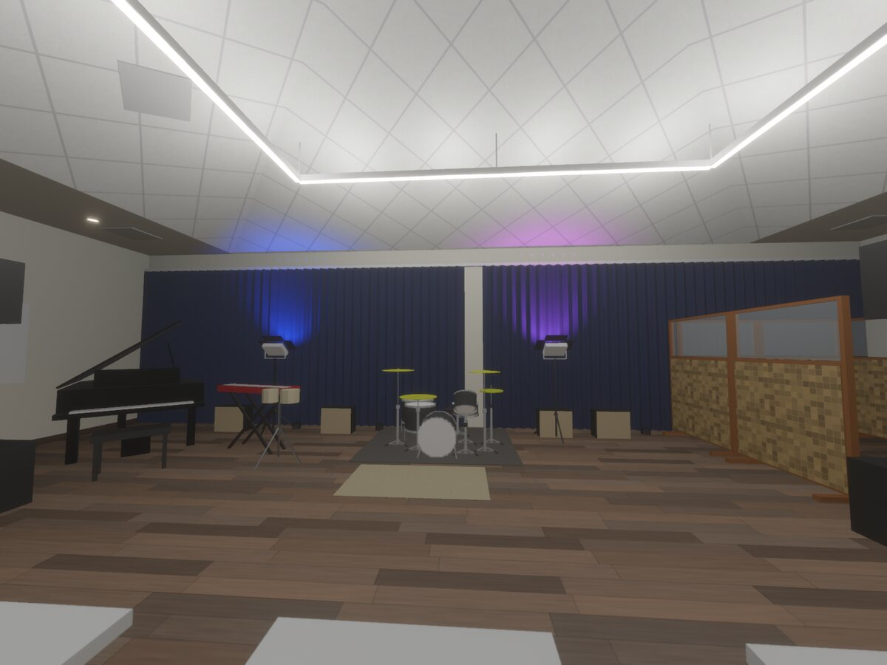
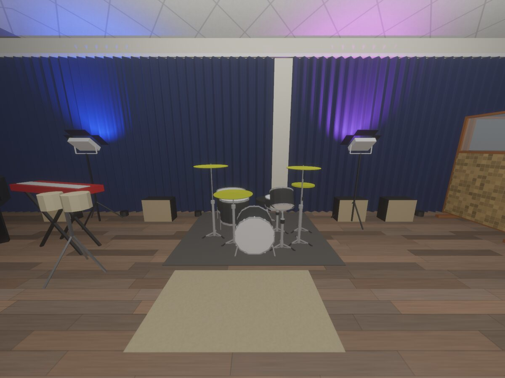
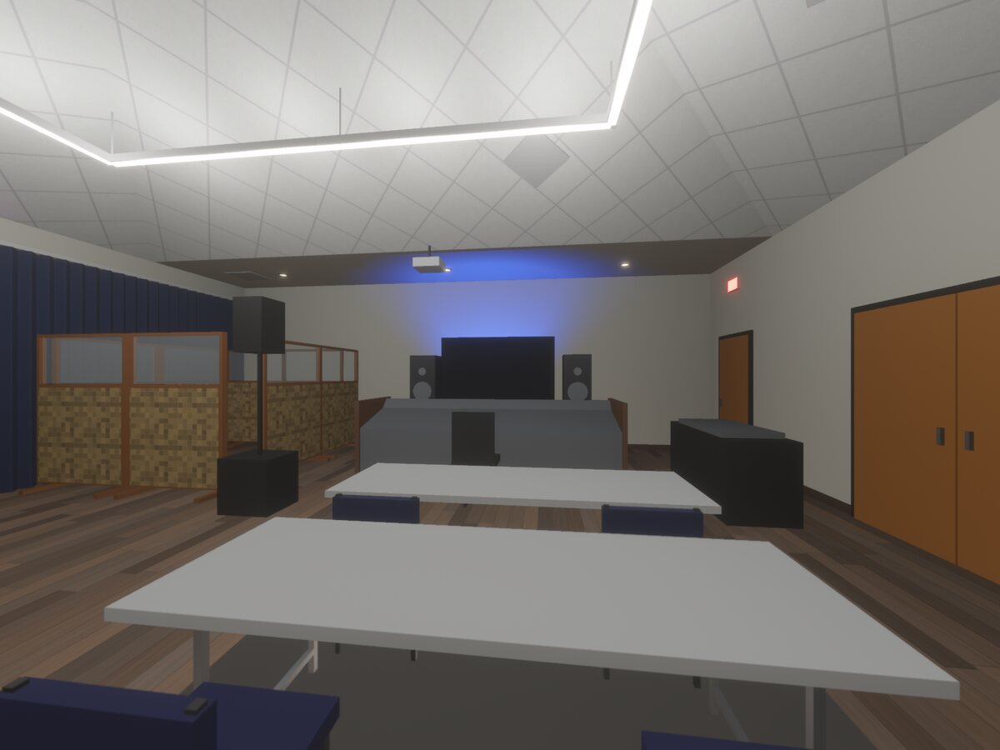
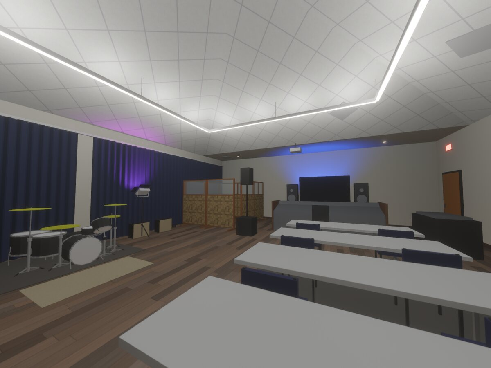
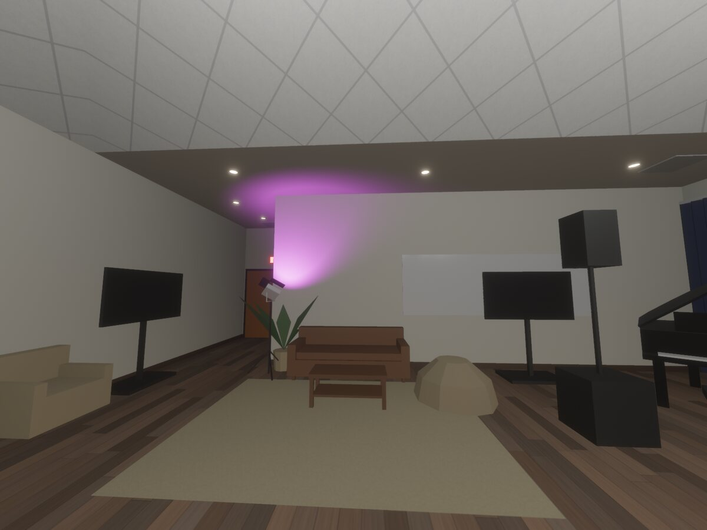
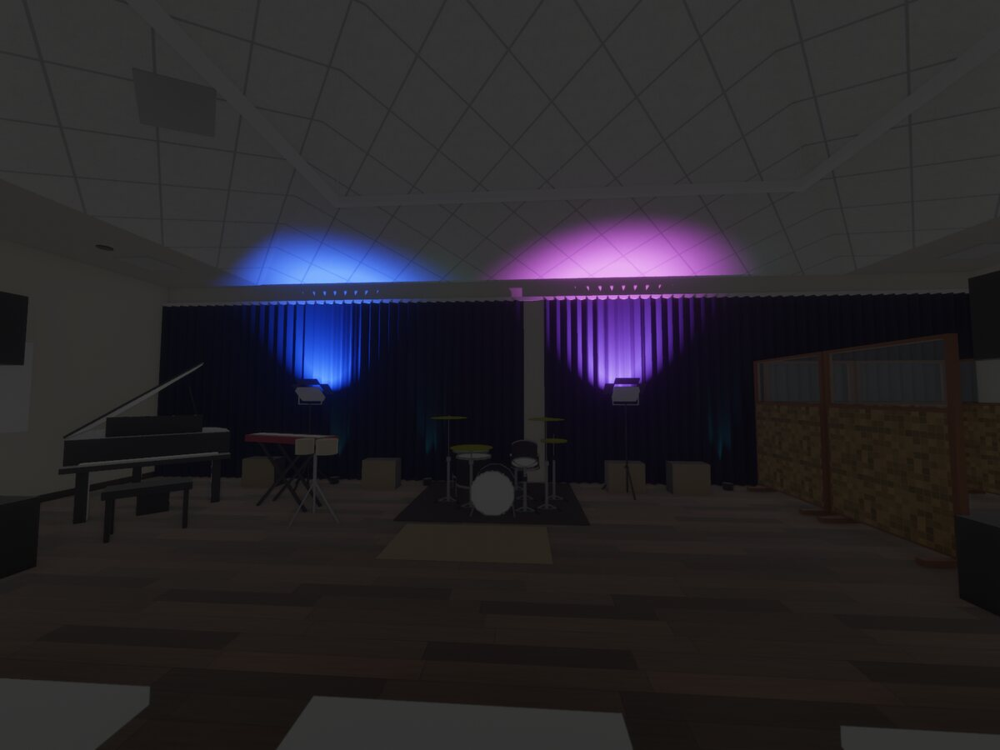

# Lab 138: the room, measured and modelled

The `room138-cbu` venue used to be six boxes drawn from a description: 48 by
35 ft under a guessed 16 ft ceiling. It is now a model of the real room, built
from a phone LiDAR scan and sixteen photographs of it, and the visualizer
loads that model as the venue's environment.

| | |
|---|---|
| Build script | `features/lighting/tools/build_lab138_room.py` (Blender, headless) |
| The data | `features/lighting/data/venues/room138-cbu/environment.json` |
| The model | `lab138-room.glb`, 634 KiB, 7,118 triangles, 80 named objects, 4 textures |
| Loader | `features/lighting/viz/src/environment.rs` |
| Acceptance frames | `features/lighting/tools/shoot_lab138.sh` |

**The model is not in this repository.** The repository is public and the room
is a real facility, so the scan, the photographs, the model and its textures
stay on the owner's disk. What is here is the script that builds the model,
the document that describes it, and renders. The script reads neither the scan
nor the photographs: every measurement taken from them is a constant in it,
with its source and its tolerance beside it.

## Loading it

```sh
cd features/lighting
blender -b --python tools/build_lab138_room.py -- --out data/venues/room138-cbu/model
just viz --venue data/venues/room138-cbu --house on
```

The visualizer looks for `environment.json` in the venue directory, and for
the model it names in `$IGNITION_ENVIRONMENT_DIR`, then in `model/` beside the
document. The model and its textures are tracked there (about 1 MB), so every
machine and every render draws the same room; rebuild it with the command
above and commit the result when the build script changes. `model/compare/`
(renders beside the room's photographs) is not tracked.
With the model there, the venue's `room.json` floor, walls and ceiling are not
drawn, though they stay as the surfaces fixtures are rigged to. Without it, a
warning says so and the boxes are drawn, now at the measured size.

`--house on|off` switches the house lights and `--env-light <group>=on|off`
any other group. Both default to what `environment.json` says, which is off:
a show starts in a dark room.

## The room's dimensions

Metres, in the venue's frame: x is stage right (-) to stage left (+), y is
downstage (-) to upstage (+), the curtain wall at y = +1.8288 where the rig
already had it.

| | Measured | Was | How sure |
|---|---|---|---|
| Along the curtain wall | 14.00 | 14.63 (48 ft) | ±0.1. Peaks of the scan's wall planes, 5 to 10 cm wide; LiDAR scale is good to about 1 % |
| Curtain wall to house-back wall | 10.12 | 10.67 (35 ft) | ±0.1, same |
| Soffits at both ends, and the corridor | 3.50 high | 4.88 (16 ft, assumed) | ±0.05. The scan's largest ceiling planes sit at 3.45 to 3.50 |
| Tile ceiling | a four-sided pyramid over the 10.2 by 10.1 m between the soffits, 3.50 at its edges, 5.45 at its point | flat | Apex ±0.15: the scan thins out up there. That it is a pyramid, and not a raised flat centre, is plain in both |
| Linear fixtures | a 5.35 by 5.25 m pendant rectangle at 3.78 | none | ±0.1 |
| Corridor | 2.85 long, 2.02 wide, off the house-back stage-right corner to a double exit door | none | ±0.1 |
| Curtain | track at 3.12, the full 14 m, one 0.35 m gap at x = -0.30 to +0.05 | none | ±0.05 |
| Console soffit / lounge soffit | 1.95 / 1.85 deep | none | ±0.1 |

The lounge is the stage-right end, the console the stage-left end. The band's
left and right in the rig (`AUDIENCE_LEFT = -1`) agree with the room: the
piano and keyboards are audience-left.

## What is modelled, and what is a proxy

**Modelled from measurement:** the floor, the six wall planes (corridor
included), the base trim, both soffits, the pyramid ceiling with the tiles
laid on the diagonal at 0.61 m, the curtain as two drapes of pleated geometry
(9 cm folds on a 17 cm pitch, 12 cm off the wall), its track, the three
doors, the linear fixtures on their pendants, the eight recessed cans, the air
vents, the projector.

**Low-poly proxies, at measured positions and sizes** (from the scan's plan,
±0.1 to 0.2 m unless noted): grand piano and bench, mixing console, console
screen and two studio monitors, side rack, four folding tables on their mat
with eight chairs, four chairs along the house-back wall, the couch, coffee
table, beanbag, armchair, plant, three stools, the lounge rug, two TVs on
stands, the whiteboard, two PA stacks (sub, pole, top), four amps, the drum
mat and stage rug, and the booth of eight rolling diffuser panels with glass
tops.

**Proxies placed from the photographs only** (±0.5 m; the scan smears them):
the red stage keyboard and the bongos. The second keyboard and the drum kit
are the venue's existing props, the kit moved to where the scan has it.

**Not modelled:** mic stands and music stands beyond the venue's one, cables,
monitor wedges, bags and cases, wall plates, the fire alarm, a tiled alcove
off the corridor, and whatever is behind the curtain (the gap shows a plain
wall). Screens are black glass and the whiteboard is blank: nothing that was
on them is kept, and there is no lettering anywhere, exit signs included.

## Materials

Base colours are linear reflectance. Where a photograph was the source, a
patch under the neutral house light was linearised and divided by the wall's
in the same frame, then scaled by the wall's assumed reflectance of 0.75 (a
matte off-white paint): the wall is the room's grey card. That removes the
exposure and most of the white balance, and it keeps the photographs' coloured
washes out, because only patches lit by the house lights were used. None of
the scan's texture is shipped. All four textures are procedural, generated by
the build script.

| Material | Linear RGB | Rough | From |
|---|---|---|---|
| Wall paint | 0.77, 0.75, 0.66 | 0.90 | Hue from a photo patch; luminance set to 0.75 |
| Soffit paint | 0.68, 0.65, 0.58 | 0.90 | Reads a shade darker than the wall in its own shadow; ±0.1 |
| Ceiling tile | 0.82, 0.82, 0.80 | 0.95 | Mineral-fibre tile, catalogue reflectance 0.80 to 0.85. Texture: one fissured tile with the grid's shadow line |
| Floor | mean 0.26, 0.17, 0.115 | 0.42 | Floor/wall luminance 0.25 gives 0.185. Texture: 0.15 by 1.2 m planks, staggered, tiling at 2.4 m |
| Base trim | 0.072, 0.038, 0.026 | 0.50 | Trim/wall 0.06 |
| Curtain velvet | 0.016, 0.026, 0.075 | 1.00 | See below |
| Door wood | 0.45, 0.166, 0.032 | 0.45 | Door/wall 0.29 |
| Piano black | 0.008, 0.008, 0.009 | 0.06 | Polyester finish: near mirror |
| Diffuser cells / frame | mean 0.37, 0.24, 0.09 / 0.30, 0.11, 0.03 | 0.70 / 0.45 | Hue from a photo; texture is an 8 by 8 grid of cells of differing depth |
| Rugs | mean 0.60, 0.50, 0.31 | 0.95 | Rug/wall 0.79, taken down to 0.55. Texture: a weave |
| Chair fabric | 0.017, 0.020, 0.078 | 0.95 | Chair/wall 0.03 |
| Table top | 0.80, 0.80, 0.78 | 0.55 | Photo |
| Couch leather | 0.20, 0.09, 0.04 | 0.50 | The patch was in shade (0.06); lifted to a tan leather. A judgement |

The rest (stands, cabinets, console, screens, glass, plant) are judged, and
`environment.json` says so against each.

**The curtain and the walls are where colour lands, so their numbers matter
most.** The curtain measures 2.4 % of the luminance of the wall directly above
it in the frame where neither is washed, and 6 to 8 % in a frame where the
stage lights are spilling on it. With the wall at 0.75 that is a reflectance
between 0.02 and 0.05; the model uses 0.027 (the luminance of the colour in the
table), navy, fully rough. That is what dark cotton velvet is expected to be,
and it means the curtain returns about one twenty-seventh of what the wall
does: a wash that is vivid on the lounge wall is a dim glow on the drape, which
is what the photographs show. The wall's 0.75 is an assumption, not a
measurement: if the paint is really 0.65 or 0.85, every photo-derived number in
the table moves by the same factor and the ratios hold.

## The room's own lights

In `environment.json` as two switchable groups, off by default.

**`house`**: the linear rectangle, sixteen points along its 21.2 m at 4,750 lm
each. That is 76 klm for seventeen four-foot sections at a nominal 4,500 lm,
540 lm/m² installed over the 141 m² room, about 350 lux on the tables. 4000 K.
And the eight recessed cans, 900 lm each in a 60° flood, 3000 K. The lit lenses
are separate objects shown only while the group is on.

Two things about this group are not physical, and both are deliberate:

- **White balance.** The visualizer's camera has no white balance, so a 4000 K
  source renders orange. The practicals are tinted relative to a 4000 K white,
  as a camera balanced on the house lights sees them (and as the photographs
  were). The linear light is white and the cans are warm beside it.
- **Bounce.** The renderer lights directly; nothing bounces. Six shadowless
  fill points three metres under the floor stand in for the light the floor
  and walls return, which in the room is all that lights the soffits.

**`found`**: the stage lights that were in the room when it was photographed.
See the next section.

## The rig against the room

The photographs and the scan do **not** show the rig that `room138-cbu`
describes. That is the main finding.

What was in the room: three white LED panels with barn doors on light stands,
each about 0.55 m from the surface it washes and tipped up at it (two at the
curtain, blue at x = -3.75 and magenta at x = +1.25, heads at 1.5 m; one in
the lounge by the plant, magenta on the stage-right end wall); at least three
small floor uplights at the foot of the curtain, teal; and a blue wash up the
console-end wall whose source is hidden behind the console screen in every
frame.

What the rig file has: four towers of six blinder rings, two trees of four
pars, four moving heads and four LED bars. None of those forty fixtures is in
any photograph or in the scan.

So there was nothing to check the forty fixtures' positions *against*. What
could be checked is whether they fit the measured room, and the photographed
lights are modelled as the environment's `found` group (objects and lights,
positions ±0.2 m, output set by eye) so the frames below can be compared at
all.

**Corrected in `tools/make_room138.py`, where the room leaves no doubt:**

| | Was | Now | Why |
|---|---|---|---|
| Room | 14.63 × 10.67 × 4.88 | 14.00 × 10.12 × 3.50 | Measured. The house-back wall moves from y = -8.84 to -8.29 |
| Wall Bars 1, 2 | y = 1.707 | y = 1.379 | They were 12 cm off the wall, which is inside the curtain |
| Movers 1 to 4 | y = 1.676 | y = 1.379 | The same. Height unchanged at 2.44 m |
| Trees 1, 2 | x = ±4.877 | x = ±2.9 | Stage left was inside the mixing console (a fixed 3.65 m desk at x = 4.15 to 5.2, y = -6.07 to -2.42); stage right was on the coffee table. All eight pars are re-aimed from the new positions |
| Drum kit, drummer, the `Drums` focus and the pars aimed at them | x = 0, y = 0.61 | x = -0.65, y = 0.78 | The scan has the kit on its mat 0.65 m audience-left of centre |

**For the owner. The evidence shows a problem but not the answer:**

1. **Which lights are the rig?** The three panels, the uplights and the
   console wash are in the room and not in the patch; the towers, trees,
   movers and bars are in the patch and not in the room. If the panels are
   part of the show they need a fixture type, a mode and addresses. They are
   in `environment.json` under `found` with positions.
2. **The movers have nothing to hang from.** They are "on the band wall at
   8 ft", and that wall is drape from the floor to 3.12 m. They are moved clear
   of it; what holds them up is still open.
3. **The diffuser booth is where four things are.** As scanned it occupies
   x = 3.35 to 6.2, y = -1.12 to +1.48. Tower 4 (x = 5.49) and Wall Bar 2
   (x = 3.66) are inside it, Mover 4 (x = 6.40) is behind it, and the second
   guitarist (x = 3.35) is standing in its near row. The panels roll, and
   their layout already differs between the scan and the photographs.
4. **The piano.** Tower 1 (x = -5.49, y = 1.52) is 0.4 m behind the grand's
   tail and Mover 1 is over it.
5. **The trees' new x** is the nearest clear floor, between the tables and
   the console chair. It is a judgement.
6. **Fixture outputs** were not checked: nothing here measures them.

## The frames

Each is the visualizer's render from where a photograph was taken (camera
presets `Photo - …` in the venue's `cameras.json`, a phone's 0.5× lens taken
as 92° tall), with `--house on --env-light found=on` and the rig left out,
since it was not up. `tools/shoot_lab138.sh <out> [photos]` remakes them, and
with the photographs writes each pair side by side. The pairs show people, so
they are kept beside the model in `model/compare/` and not here.

| Photograph | Render |
|---|---|
| IMG_5797: the curtain from the tables |  |
| IMG_5790: the stage from in front of the kit |  |
| IMG_5782: the console end |  |
| IMG_5786: the curtain's stage-left half and the console |  |
| IMG_5784: the lounge |  |

And the curtain view with the house lights off, which no photograph shows:
what the drape does with colour in the dark.



### What matches

The room's proportions, the soffit and pyramid lines, the diagonal tile grid
and the linear rectangle against it; the curtain's extent, gap and height;
where the piano, kit, booth, console, tables, doors, couch, TVs and PA stacks
fall in each frame; the blue and magenta washes, in the right places with
their spill on the tiles above; the lounge wash's shape on the end wall.

### Where the render is still off

- **Light.** The house light is shadowless and unbounced. Nothing sits in its
  own shadow, so the walls under the soffits are brighter than in the
  photographs and the coloured washes on them read weaker for it. The console
  wall's blue is the worst case: a deep saturated field in the photograph, a
  pale one here, even at three times the panels' output. There are no contact
  shadows under furniture, and the floor does not carry the long reflections
  of the linear fixtures that the photographs show.
- **Colour.** The photographs are warmer and more saturated: the floor is a
  richer brown, the tiles near the fixtures yellow-green. The render is close
  to neutral. Some of that is the phone's processing. The curtain is a little
  lighter and bluer in the render than in the photographs.
- **The washes.** Right place and colour, wrong shape in detail: the real ones
  are a tight hot spot behind the head with a long soft fall-off; the render's
  are a broader, flatter cone. The uplights' teal barely registers.
- **Dressing.** The photographs are full of mic stands, music stands, cables
  and cases; the render has none of it, so the stage looks empty. The kit is
  the stock prop, the console is a sloped slab, and the chairs are stand-ins
  for chairs that move every day.
- **Registration.** Camera positions were solved from two or three landmarks
  per frame and are good to about 0.3 m and a few degrees. The stage rug sits
  nearer the camera than in the photograph, and the panels' heads a little
  higher in frame.
- **The booth.** The far two rows are in the scan only, as low lines, and the
  near rows sit about 0.5 m differently in the photographs than in the scan.

## For the environment-editing actions

`environment.json` is the data an edit changes; the GLB is only shapes.

```
{ version, name, model, measured{…}, materials[…],
  light_groups: [{ name, label, on }],
  objects: [{ name, kind, position{x,y,z}, eulers{x,y,z}, size{x,y,z},
              visible, movable, group?, note? }],
  lights:  [{ name, group, kind: point|spot, position, lumens, color[3],
              range, radius, shadows, aim?, cone_deg?, note? }] }
```

- An object is a `room.json` record (`name`, `position`, `eulers`, `size`) with
  `kind` (`architecture`, `furniture`, `gear`, `practical`, `found-light`),
  `visible` and `movable` beside it. `name` is also the node's name in the
  GLB. `position` is the object's origin, on the floor under it, in venue
  metres; only `eulers.z` is applied; `size` is informational.
- An object with a `group` is a lit lens, shown only while that light group is
  on.
- At run time the document is the `EnvironmentRes` resource. Changing it
  (move, hide, `Environment::switch("house", true)`) is picked up by
  `apply_environment` on the next frame. Nothing reads a pose back from the
  model, and unknown keys survive a round trip.
- Saving the resource back to the file is not written. Re-running the build
  script overwrites the file, so an edit meant to last belongs in the script
  until that exists.
- People are not in it: they stay in `props.json`.

## What is left

- A save path for `environment.json`, and deciding whether hand edits or the
  script wins.
- Shadowed house light (sixteen cube maps is over the visualizer's budget; an
  area-light or baked answer would be better) and a real bounce.
- The rig questions above.
- Stage dressing: mic and music stands, wedges.
- The model's home. It is on one disk; a private asset store would let a
  second machine load the room.
