# Analytic beams: what was built, what it looks like, what it costs

2026-11-18. The crate is `features/lighting/beams` (`ignition-beams`); its
README has the design, the tiers, what was ported from ASLS Studio and how
it is wired into the visualizer. This page is the evidence: captures of the
cases that break the marched fog, and the measured GPU time.

Bevy: upstream `main` at `948cc8270204b46fd37353eb786144a677d0c0ce`
(2026-11-12), the revision `feat/bevy-fork-gpu-frames` chose. The crate is
its own small workspace until that branch lands, so it is not in the root
`--workspace` builds or CI yet.

## Reproducing

```sh
cd features/lighting/beams
cargo test --release                                             # 44 tests, no GPU
cargo run --release --example truss -- --headless --out target/tmp/beams
cargo run --release --example truss -- --bench --size 5120x1440 --beams 70 --tier high --out target/tmp/bench.json
cargo run --release --example truss                              # a window
```

Headless needs no display. The pictures below are those PNGs at 1920x1080
(72 fixtures, tier high), scaled to 1600 wide as JPEG to keep the
repository small; the two crops are PNG at 4x.

## Captures

Each scene was looked at as the full-size PNG, and the narrow shafts at
4x.

| Scene | What it shows | Seen |
|---|---|---|
| 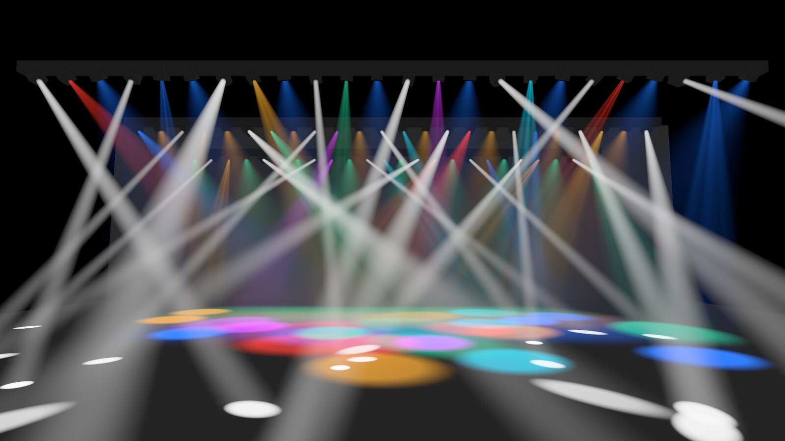 | `show`: 72 movers, sweeps, colours, a 12.5 Hz strobe, rotating gobos | Smooth shafts, cut cleanly at the floor. |
| 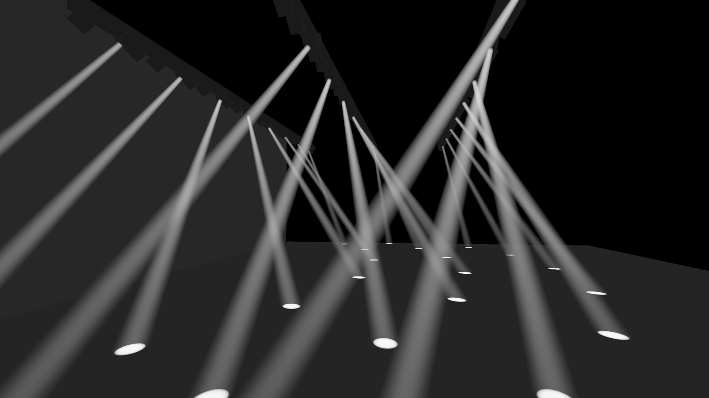 | `side-pan`: 24 beam fixtures of 1.8°, panning about six radians a second, from the side. Three consecutive frames at 60 a second | Each frame is as clean as a still: there is no history to reject. |
| 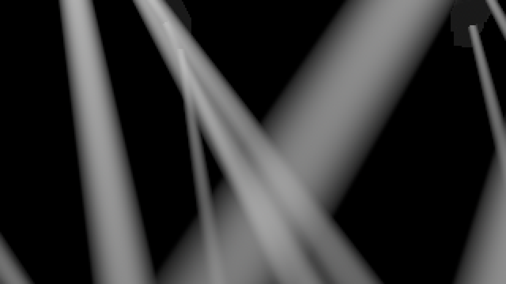 | The same at 4x | No beads, no steps along the shaft, no facets. |
| 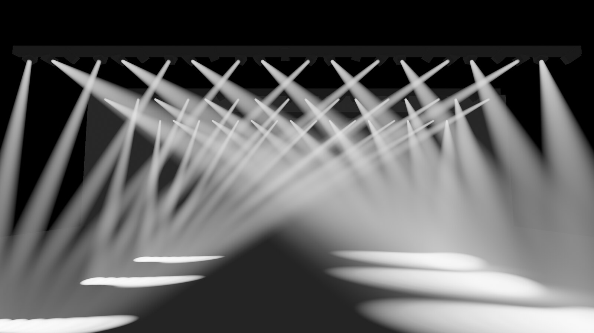 | `alias`: the cue in `data/songs/beam-alias.json` rebuilt on this rig. Every mover full white, the two ranks crossed steeply in the air | The picture the fog beads on. Continuous shafts. |
| 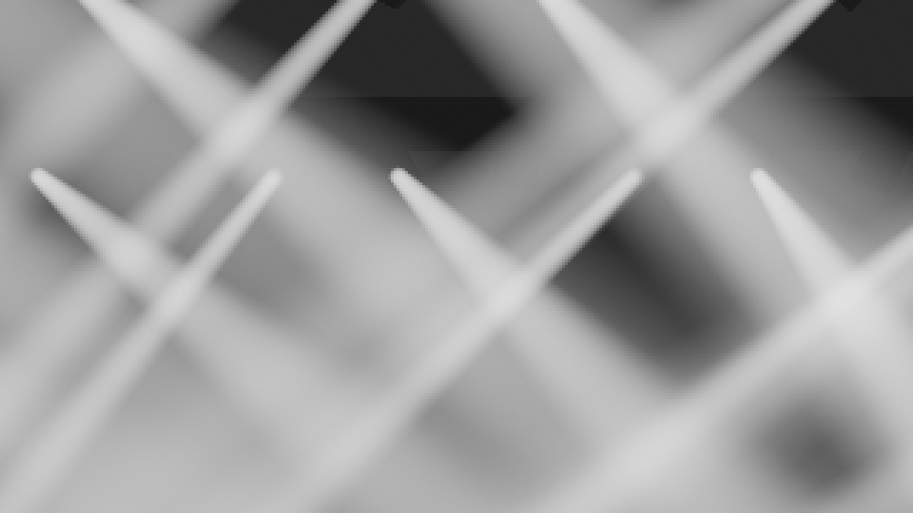 | The crossings at 4x | Smooth through each crossing. |
| 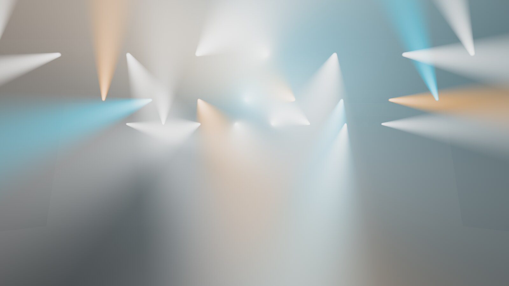 | `at-camera`: 24 beam fixtures aimed at the lens, from dead on to a miss | Beams looked into are bright and pale to white; the ones that miss pass as shafts. No hull edge, no pop. |
| 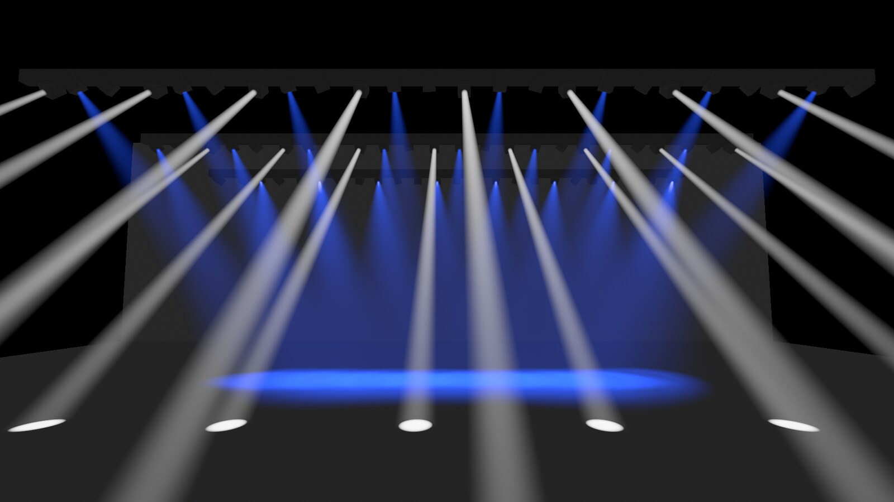 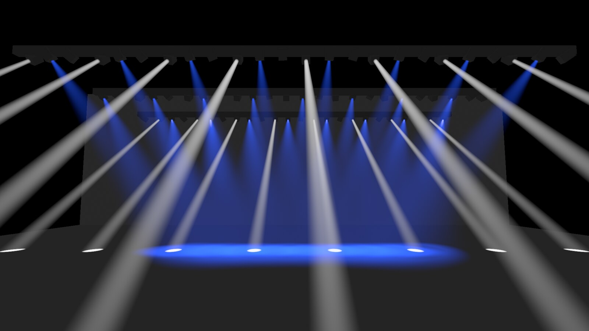 | `strobe`: 25 Hz, two consecutive frames | A strobe is a dimmer value: a frame has the beam or does not. |
| 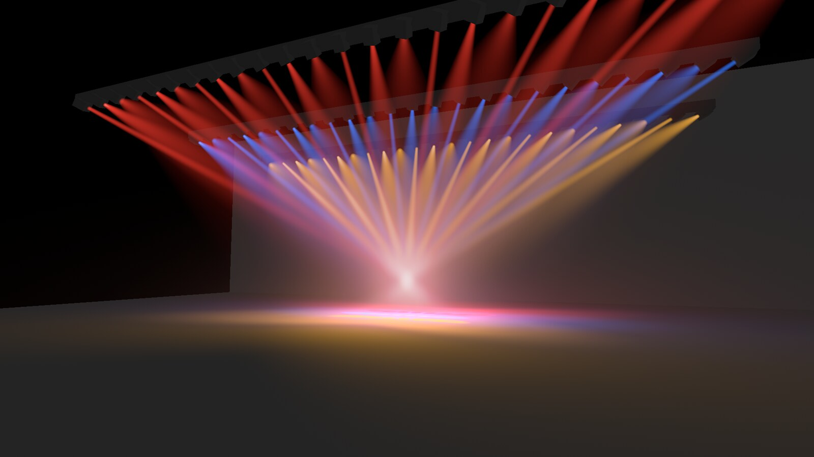 | `overlap`: all 72 on one point | Additive; the hot centre pales to white instead of clipping in a colour. |
| 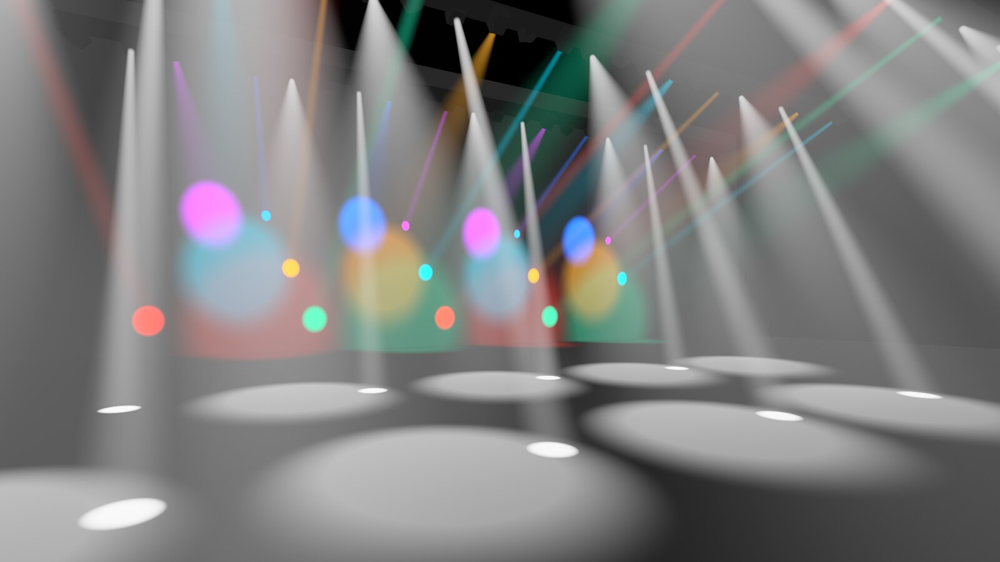 | `floor-wall`: beams ending on the floor and on the back wall | Cut by the depth buffer at the surface. |
| 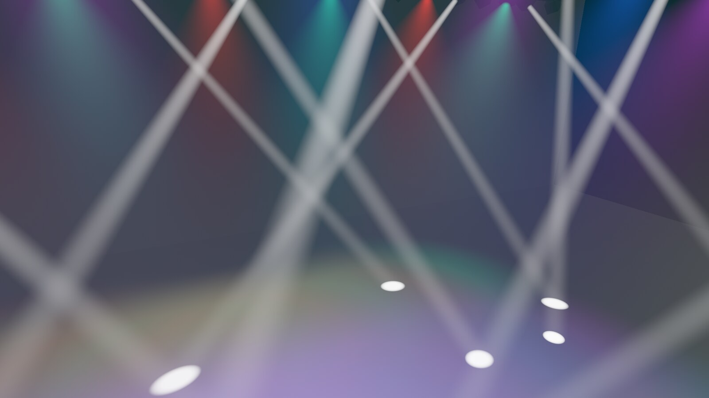 | `inside-wash`: the camera 1.7 m under a wash, in its cone | The wash is a smooth veil; beams cross it cleanly. |
| 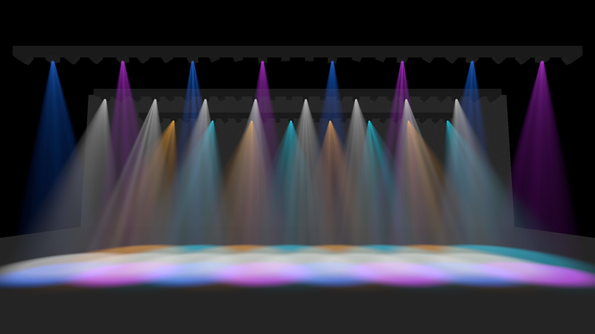 | `gobos`, tier high: the gobo averaged along each ray | Streaks in the shaft, no noise. |
| 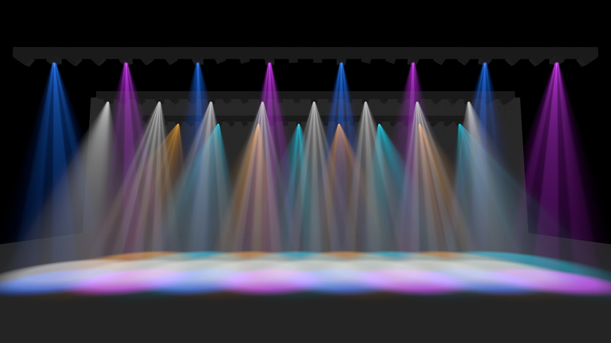 | `gobos`, tier medium: one gobo sample at the closest approach | Stronger streaks; it is a single slice of the gobo. |
| 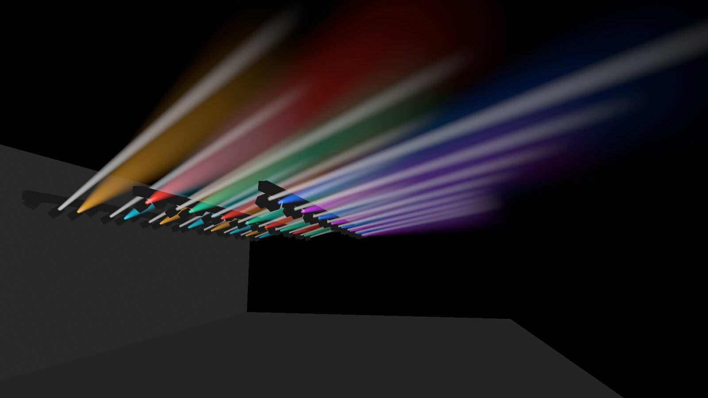 | `end-fade`: beams thrown into open air with a short reach | Each ends in its fade. No cap, no disc. |
| 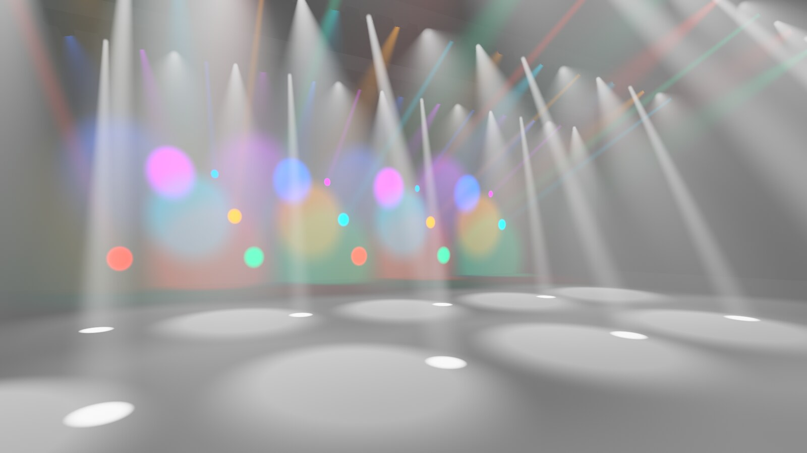 | `floor-wall` with the air target at half resolution (the governor's last resort) | Softer edges, nothing else. |
| 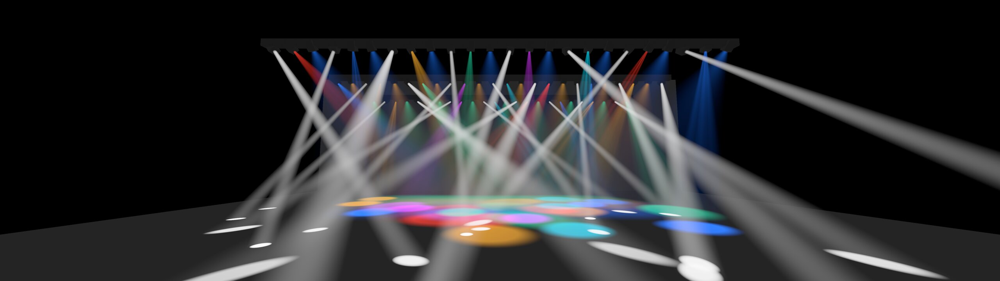 | `show` at 5120x1440 | As above. |

### Defects found, and what was done

- **Fixed: beams the camera was in vanished, and beams passing close had
  straight cut edges.** The hull's faces were wound the other way round
  from what the pipeline assumed (a beam's basis is left-handed about its
  axis), so the near faces were drawn. Inside a cone there were none, and
  near ones were cut by the near plane. The first `at-camera` capture
  showed it.
- **Fixed: a ray exactly along a beam's axis got no segment.** Its
  discriminant is zero and rounded below. A unit test found it.
- **Fixed: jittered gobo samples showed as a fine screen pattern** in a
  gobo's shaft at tiers high and ultra. The samples are prefiltered, so
  the jitter now defaults to none (`BeamCamera::gobo_jitter`).
- **Not fixed: banding near white.** With many beams aimed at the lens the
  frame is nearly white and the tonemapper's 8-bit output steps are
  visible as faint bands. The beams' own dither is applied before the
  tonemapper and is too small there; the example turns on Bevy's
  `DebandDither` as well, which should be kept on in the visualizer.
- **Not a defect, but it will be asked about:** in `inside-wash` there is
  a hard vertical edge at the right. It is the end of the back wall;
  beyond it there is no surface, so the beams run on.
- **Looks:** narrow beams read softer than ASLS's because the profile
  follows the beam and field angles out to 1.15 × the field. Washes are
  dim beside beam fixtures, as they are in a room: brightness is the
  fixture's flux over its solid angle with nothing tuned by eye. Both are
  one number each to change (`EDGE_OVER_FIELD`, `Haze::scattering_at_full`
  and exposure).

Not seen in any capture: blocks, beads, lattice, facets from the hull, a
far cap, popping at the cone's edge.

## Cost

GPU time of the beam pass (both of its render passes) from Bevy's render
diagnostics, `render/ignition_beams/elapsed_gpu`: timestamp queries around
the pass, 240 frames per scene after 40 to warm up. RTX 4080, release
build, in a headless Loft test session on the GPU (`loft-dev --session
beams --gpu`), rendering offscreen. The GPU was shared with the desktop
and another agent's renderer, so the table quotes the **median**; the
largest single frame was typically 1.3 to 2 times it. Load average during
the run: 6.2 to 7.4.

"70" and "200" are the fixtures on the rig; how many are lit depends on
the scene (`alias`: two thirds; `at-camera`: one third; the rest: all).

Median milliseconds:

| 2560x1440, 70 | show | alias | overlap | at-camera | inside-wash |
|---|---|---|---|---|---|
| low, half-res air | 0.21 | 0.17 | 0.34 | 0.26 | 0.35 |
| low | 0.63 | 0.47 | 1.13 | 0.85 | 1.24 |
| medium | 0.87 | 0.64 | 1.53 | 1.18 | 1.77 |
| high | 1.23 | 0.78 | 2.01 | 1.49 | 2.21 |
| ultra | 2.15 | 1.37 | 3.38 | 3.12 | 3.81 |

| 2560x1440, 200 | show | alias | overlap | at-camera | inside-wash |
|---|---|---|---|---|---|
| low, half-res air | 0.53 | 0.40 | 0.87 | 0.65 | 0.93 |
| low | 1.82 | 1.31 | 3.32 | 2.78 | 3.48 |
| medium | 2.51 | 1.83 | 4.31 | 4.14 | 4.87 |
| high | 3.68 | 2.68 | 5.06 | 4.69 | 6.11 |
| ultra | 6.36 | 5.96 | 9.06 | 9.10 | 11.00 |

| 5120x1440, 70 | show | alias | overlap | at-camera | inside-wash |
|---|---|---|---|---|---|
| low, half-res air | 0.27 | 0.21 | 0.45 | 0.49 | 0.60 |
| low | 0.72 | 0.53 | 1.45 | 1.70 | 2.11 |
| medium | 0.97 | 0.71 | 2.12 | 2.31 | 2.85 |
| high | 1.37 | 0.86 | 2.33 | 2.87 | 3.67 |
| ultra | 2.41 | 1.81 | 2.12 | 5.25 | 6.56 |

| 5120x1440, 200 | show | alias | overlap | at-camera | inside-wash |
|---|---|---|---|---|---|
| low, half-res air | 0.61 | 0.46 | 1.10 | 1.25 | 1.58 |
| low | 2.03 | 1.44 | 4.05 | 4.50 | 5.84 |
| medium | 2.72 | 2.13 | 5.26 | 6.16 | 8.23 |
| high | 3.87 | 3.66 | 6.43 | 7.97 | 10.39 |
| ultra | 6.73 | 6.44 | 11.21 | 14.14 | 18.09 |

Reading it:

- **The report's estimate was 0.5 to 3 ms for 70 fixtures at 5120x1440.**
  Measured: 0.5 to 2.1 ms at low, 0.9 to 3.7 ms at high, up to 6.6 ms at
  ultra. A wide shot of a show is about 1 ms; the estimate holds except
  for the worst views at the top two tiers.
- **The worst case is the camera inside a wide wash,** as expected: every
  pixel runs every wash that contains the eye. Beams aimed at the lens
  come second.
- **Cost follows covered pixels × beams over them, not the frame's
  size.** 5120x1440 shows the same stage at the same height as 2560x1440
  with empty space beside it, so a wide shot costs about the same; the
  views that fill the frame (`at-camera`, `inside-wash`) cost up to twice
  as much. It is close to linear in the number of beams.
- **200 beams at ultra does not fit a 60 Hz frame in the worst views**
  (18 ms). That is what the governor is for: high is 10 ms there, low
  5.8 ms and half-resolution air 1.6 ms.
- For comparison the report quotes about 15 ms for the march this
  replaces, at 5120x1440.

Not measured here: the room's own cost (clustered spot lights for the
pools), an M-series Mac, and the pass inside the real visualizer.
