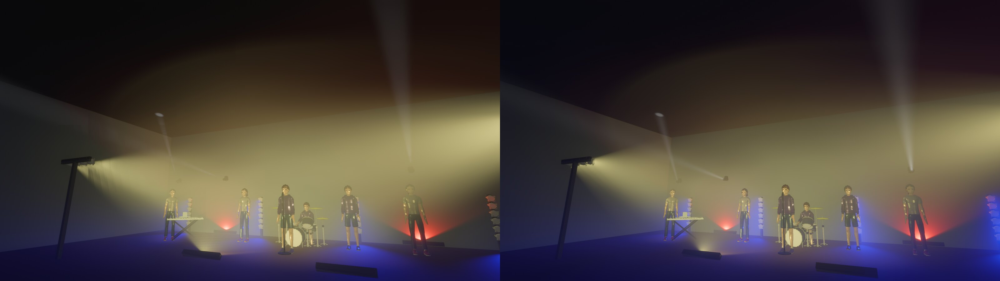
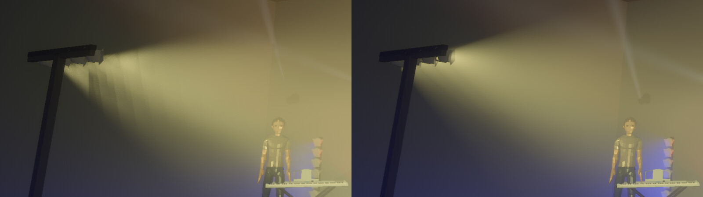
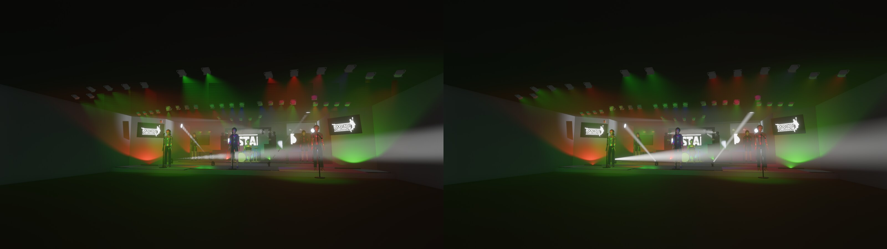
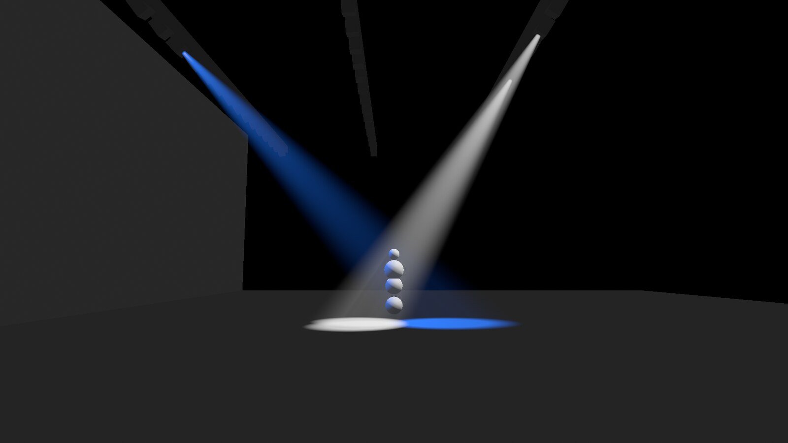
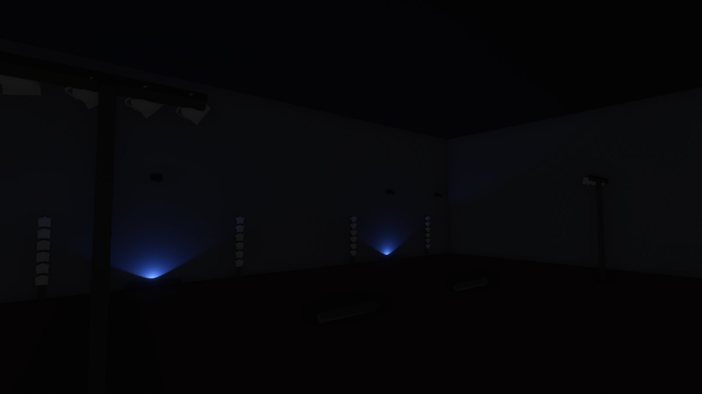

# The beam pass in the visualizer

2026-11-18, branch `feat/beams-in-visualizer`, cut from
`feat/bevy-fork-gpu-frames` at 11ce1df (Bevy `main` 948cc8270, wgpu 30,
dma-buf frames) with the three `feat/analytic-beams` commits on it. The
crate is `features/lighting/beams`, now a member of the workspace on its
Bevy; the wiring is `features/lighting/viz/src/beams.rs`.

Every fixture's light in the air is the analytic beam pass. Bevy's
volumetric fog is not on the cameras and nothing is marched.
`IGNITION_BEAMS=0` puts the fog back in place of it, only to compare.

## What a beam is given

Each emitter gets beams in the air as children (three where the fixture
has a prism), written every frame from what the visualizer had already
resolved for the fixture:

| | from |
|---|---|
| Beam and field angles | the spill light's cone: the profile's `<Beam>` angles, zoomed by the wire (`update_beams`) |
| Flux | the profile's `LuminousFlux` when the file states one, else watts × 38 lm/W as before. A flux of exactly GDTF's default (10 000 lm) is taken as unstated: on a 36 W par it would be seven times too much. The spill light uses the same number, so pools and shafts agree |
| Lens | the profile's `BeamRadius` (0.05 m without a profile). The beam starts at that width |
| Colour, dimmer, strobe | `EmitterState::color`, which has the dimmer and the strobe's shutter in it |
| Pan, tilt | the transform tree, like everything under the emitter |
| Gobo | the wheel slot the wire selects, from one texture holding every wheel's masks; it turns with the wheel |
| Prism | three beams, each a third of the flux, thrown off the axis as the three decals are |
| Haze | the hazers' settled level × the `--haze` dial; the uneven, drifting banks of `haze_texture.rs` |
| People | each person is four spheres that cut the beams they stand in (tiers high and ultra) |

Not given, because the visualizer does not resolve them: **frost**, focus,
iris (no attribute reaches `EmitterState`), and zoom in real degrees (it
is still half to one and a half times the nominal angle).

The quality presets pick the tier from their air dial: potato and low are
tier low, medium is medium, high is high, ultra and stills are ultra.

## Frame time

The method of `frame-breakdown.md`: the JT recital rig (`room138-cbu`, 40
emitters), the chorus of song 8 from bar 31 with the clock running, the
`medium` preset, `features/lighting/tools/frame_breakdown.sh`, p50 over
300 frames, beams and fog run in turn three times. RTX 4080, shared with
the desktop. Load average 14 to 33.

Frame through the pane as dma-bufs, median of the three runs' p50s,
milliseconds:

| | before (0.19.1, shm) | fog on this branch | **beams** | frames a second |
|---|---|---|---|---|
| 2560x1440 | 22.0 | 17.4 (17.2 / 17.5 / 17.4) | **5.8** (5.8 / 6.9 / 5.8) | 57 → 171 |
| 5120x1440 | 47.9 | 40.0 (39.9 / 40.0 / 40.0) | **11.4** (11.4 / 11.5 / 11.4) | 25 → 86 |

With no transport (`ignition --bench`) the beams are 5.8 / 6.4 / 5.8 and
11.4 / 11.5 / 12.9 ms; the fog 17.3 / 17.6 / 17.6 and 39.9 / 40.0 / 39.7.
The second beams run caught a burst of load and is reported, not dropped.

- The frame is no longer bound by the air. At 2560x1440 `update` (the
  CPU) is 2.8 ms of the 5.8 and the GPU's wait 3.0.
- Those runs were taken before the uneven haze reached the beams. With it
  the same cue is 6.6 ms p50 at 2560x1440 (`viz --bench`, medium), about
  0.6 ms for the haze's texture.
- **Occluders are not in the medium tier.** With six people in every wash
  the shadow tests took the same cue from 5.8 to 10.8 ms, so they are on
  tiers high and ultra only. At `IGNITION_QUALITY=high` the cue is
  15.4 ms at 2560x1440, with everything else that preset turns on.
- A last three-run matrix after those changes was taken while the machine
  was at a load of 55 to 135. Its CPU phase is two to four times longer
  (`update` 3.6 to 12 ms) and it is not quoted; its GPU wait was 3.4 to
  4.8 ms at 2560x1440 and 7.3 to 9.5 ms at 5120x1440.

## Stills, the fog and the beams

Same cue, camera, size and effect time (`viz --snapshot --time 2.0`,
`IGNITION_QUALITY=medium`, 2560x1440). The fog (`IGNITION_BEAMS=0`) on
the left, the beams on the right.

The tree's wash at full size, where the fog steps:

- **The fog's blocks are gone.** Left: bands across the wash where it
  leaves the pars, and at Norco a mover's shaft drawn as dots. Right:
  neither.
- **Brightness is set by one number,** `AIR_SCATTERING_PER_METRE` (0.25,
  `IGNITION_AIR_SCATTERING` to try another), chosen so the recital's
  chorus reads as it did under the fog. The fog's own gain was tuned by
  eye in other units, so this is a match by eye too.
- **What differs.** The beams start at the lens's width and the movers'
  shafts are brighter and longer; the pars' wash in the air at Norco is
  fainter than the fog's; the tower bars' blue veil near the floor is a
  little stronger.
- `data/songs/beam-alias.json` at Norco rendered black on both paths at
  `--time 2.0` (the hazers have not come up) and is not shown.

Something solid in a beam (the example's `occluder` scene, tier high): a
figure of four spheres, and each shaft dark behind it.

## Against the real room

The owner's standard is that the visualizer looks right, and the first
ground truth is 16 photographs of Lab 138 with some of the rig lit, and
a LiDAR scan (`vaults/fasttrackaudio/Projects/lab-138-room/`, not in this
repository: they show people).

**They cannot be matched to this venue yet, and no side-by-side is forced
here.** What stands in the way:

- The photographs are of the room as it is day to day: house lights on, a
  blue wash up the wall behind the console, magenta up another wall and
  across the ceiling tiles, small cyan uplights at the curtain. The
  `room138-cbu` venue is the recital's rig (towers, trees, movers, bars),
  generated from the room's stated size as a bare box. Which patched
  fixture, if any, is each lit one in the photographs is not recorded.
- The room in the photographs has a blue curtain wall, a console, baffles,
  doors, a tiled ceiling with a raised centre. The venue has none of
  them. `feat/lab-138-room-model` is building that room and correcting
  the fixtures' places; it had not been pushed when this was written.
- The photographs are ultra-wide phone frames from unrecorded positions.
- There is no haze in them, so they say nothing about the beam pass.

What they do show is how light lands on surfaces, which is the half of
"looks right" the beam pass does not draw. One render to hold beside
them: the two wall bars in blue against the band wall, no haze, from the
house.

Against the photographs' wall washes, in order of how wrong it looks:

1. **The size and shape of a wash.** Real: a wash climbs the whole wall,
   three metres and more, and spills across the ceiling, brightest a
   metre up and falling away smoothly. Rendered: a fan that stays within
   a metre of the floor with straight diagonal edges. The bar's light is
   one spot light whose cone is the profile's angle; a batten against a
   wall needs to be an area source (or a row of them), and its cone on
   the surface needs the profile's falloff, not a spot light's
   inner-to-outer ramp.
2. **How bright it is against the room.** Real: the wash is the
   brightest thing on a white wall under house lights. Rendered: it
   barely lifts the wall. Part is the flux (the bars have no profile
   flux, so watts × 38), part the exposure, which adapts to a dark frame.
3. **Bounce.** Real: a blue wall tints the ceiling and the floor near
   it; magenta light fills the ceiling's coffer. Rendered: nothing leaves
   the surface it lands on. This needs indirect light: Solari on the
   NVIDIA tier, or a cheap bounce term per wash.
4. **Colour on white.** Real: saturated LED blue goes pale, nearly
   white, at the hot core and deep blue at the edge. Rendered: one blue
   throughout. This needs emitter colours from the profile and a
   tonemapper that is let to desaturate the core; the beam pass already
   pales its own highlights.
5. **The room unlit.** Real: nothing is black; house lights and bounce
   leave every surface readable. Rendered: black outside the pools. The
   `--ambient` dial at 0.6 changed almost nothing in this render.
6. **The fixtures' own glow.** Real: an uplight's face is a white-hot
   point with a halo. Rendered: the housing glow is deliberately dull.
   Bloom on an emissive lens disc at the fixture's real luminance would
   do it.

The beam pass has no item on this list; nothing in it was changed for
it. Items 1, 2, 4 and 6 are surface lighting and colour in the
visualizer; 3 is global illumination; 5 is ambient and exposure.

**What would make a real comparison.** After the room model lands: for
each look, a locked-off camera (tripod, the phone's 1x lens, position
measured from two walls and its height), house lights off, haze at a
noted level (and one set with none), each of these held static and the
DMX values written down: one mover's beam straight down and at 45°
across the room; one par on a wall at a known distance; the wall bars at
full in one colour; a tower at full; two beams crossing. The recital
videos (about 724 MiB in the same vault) come after the photographs and
were not opened for this.

## What is verified, and how

| | how |
|---|---|
| The beams draw every emitter's light in the air in the real visualizer | The stills above, read at full size; `viz --bench` and `ignition --bench`; the pane's frame-breakdown runs (frames as dma-bufs, read back lit by the test's second device). |
| No blocks | The stills, and the example's captures (`analytic-beams.md`). Stills only: no moving capture was made in the visualizer. |
| The fog is off for beams and comes back when asked | The two columns above are the same binary with `IGNITION_BEAMS` unset and `0`. |
| The WESL is the Rust | `tests/wesl_matches_rust.rs` runs `scatter.wesl` on the CPU (`wesl`'s evaluator) and compares the ray's segment, the scattered light, the profile, the phase and the lit spans behind occluders with `math.rs`, to two parts in ten thousand. The other two shader files have no such test. |
| An occluder cuts the shaft behind it | Unit tests on the shadow cone and the lit spans; the example's `occluder` capture. In the visualizer it ran at `IGNITION_QUALITY=high` without error; no still there shows a cut shaft plainly. |
| Uneven haze | Runs in the visualizer with no error and costs 0.6 ms; **not judged by eye** against the fog's banks. |
| Gobos and prisms in the air, in the visualizer | Unit tests on the facets' share of the light and the mask's reading. **Not seen**: neither cue above selects a gobo, and no still was made with `IGNITION_VIZ_GOBO`. Whether the pattern in the air is the right way round against the decal on the floor is unchecked. |
| GDTF flux and lens radius | Read and used; **not checked** fixture by fixture against the watts they replace. |
| The pane in Architect's window, macOS | Not run. |

## Seeing it in Studio

Not done here: the stack's checkouts and the running Studio were left
alone.

1. The stack's Ignition checkout on `feat/beams-in-visualizer`. It
   contains `feat/bevy-fork-gpu-frames`, which is where the pane stopped
   forcing shared memory (99cfefe: `features/lighting/pane/src/ext.rs` no
   longer sets `ARCHITECT_PROCESS_VIEW_TRANSPORT=shm`). Nothing else has
   to change for the beams themselves.
2. Rebuild both halves: the `ignition` renderer, and `studio-architect`,
   because `ignition-pane` is linked into it and its old copy still
   forces shared memory. The beams would draw either way (they are in the
   renderer); the dma-buf frames need the new pane.
3. Open "Lighting: show the room". The pane's stats line says `dma-buf`.
   `IGNITION_BEAMS=0` in the renderer's environment shows the fog again.
