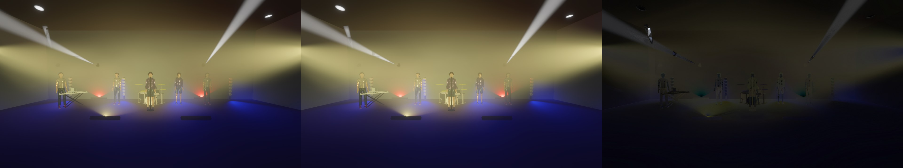
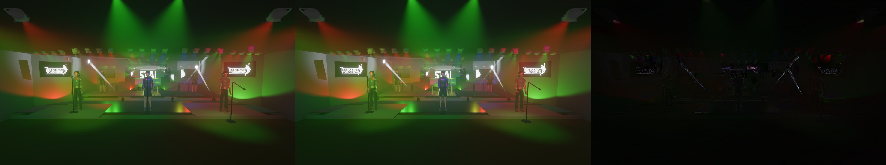

# Where a pane's frame goes

Measured 2026-11-18 on THEBATTLESHIP (Ryzen 9 9950X3D, RTX 4080, NixOS,
Vulkan), release builds, the JT recital rig (`data/venues/room138-cbu`:
40 emitters, 39 lit and in the haze, 4 with shadow maps), the `medium`
preset (32 fog steps, TAA, SSR), the chorus of song 8 ("Figure It Out",
from bar 31, the clock running). This is the baseline the Bevy move, the
GPU-shared frames and the beam renderer are judged against.

## Reading it

A pane's frame (`apps/ignition/src/process_view.rs`, `draw`) is a
`pane.frame` span (target `ignition::profile`) whose fields are its
phases in microseconds:

| field | what it is |
|---|---|
| `update_us` | the show followed and the visualizer stepped (`viz.render`): the main world's update and the extraction, which waits for the render thread to have finished encoding the frame before |
| `drain_us` | `IGNITION_FRAME_DRAIN=1` only: a wait for the GPU before the copy |
| `submit_us` | the copy out of the target encoded and submitted |
| `wait_us` | the wait for the GPU (`poll(Wait)`): the rendering still running, the copy, and in shared memory the readback's mapping |
| `memcpy_us` | shared memory: the readback copied into the slot |
| `send_us` | the frame's message sent |
| `total_us` | the whole frame (the wire's `render_us`) |
| `interval_us` | from the frame before's start to this one's: `total_us` plus the wait for the app |
| `transport`, `fallback` | how the frame reached the app, and why not on the GPU when it did not |

Every 300 frames (`IGNITION_FRAME_STATS=<n>`, 0 for never) one
`ignition::frames` event says each phase's p50 and p99 and the load
average. `ignition --bench <frames> --size <w>x<h>` draws the same show
through the same code with no pane and no transport.
`features/lighting/tools/frame_breakdown.sh <label>` runs the whole
matrix (interleaved, so a change in load lands on every mode alike) and
writes one line per run.

The devices are headless: nothing here opens a window or touches a
desktop session, the owner's or a test one.

## What the numbers mean (read this before the table)

Three things found while measuring change how the phases read.

1. **The frame is bound by the GPU, and almost all of that is the fog.**
   With no transport at all a frame is 20.6 ms at 2560x1440 and 45.9 ms
   at 5120x1440. The fog's step count alone moves it, linearly (same
   cue, `viz --bench`, 2560x1440, load 12 to 13):

   | `IGNITION_FOG_STEPS` | 8 | 16 | 32 (medium) | 64 |
   |---|---|---|---|---|
   | frame, ms (avg) | 8.4 | 13.0 | 22.6 | 41.2 |

   About 0.59 ms a step: at 32 steps the march is about 19 ms of the
   22.6, and everything else (scene, 4 shadow maps, TAA, SSR, bloom,
   tonemapping, and the CPU) is about 3.6 ms.
2. **The CPU already overlaps the GPU.** The embedded visualizer keeps
   Bevy's pipelined rendering, so `update` returns once the frame is
   extracted and the render thread encodes and submits it afterwards.
   In steady state the interval between frames is the GPU's time for one
   frame, and `wait` is that time less `update`: the two do not add to
   more than the GPU's frame. The report's guess that one frame in
   flight serialises CPU and GPU, and that this is the 10 ms floor, is
   not what happens.
3. **The frame sent is the one before the update just run.** The copy
   is submitted before the render thread has submitted the new frame, so
   it takes the target as the frame before left it. A pane is one frame
   further behind its input than `update` suggests. (Seen in the
   `shm-upload` runs: when the app is busy for a frame's length, the
   next `wait` is 1 to 2 ms, which it could not be if the copy waited
   for the frame just extracted.) Not changed here; copying from the
   render world, after the camera has drawn, would remove it.

So `IGNITION_FRAME_DRAIN` does not split the wait cleanly (it makes the
frame bimodal); the transport's cost is read from the interval, with and
without it.

## Before: Bevy 0.19.1, wgpu 29, frames through shared memory

`origin/main` at 6659bb2 plus the instrumentation. p50 over 300 frames
after 60 not counted; three runs each, interleaved; milliseconds. "load"
is the one-minute load average when each run began: the machine was
building for other threads throughout (16 cores, 32 threads).

### 2560x1440

| | load | update | wait | memcpy | frame (interval) p50 | p99 |
|---|---|---|---|---|---|---|
| no transport (`ignition --bench`) | 33 / 22 / 23 | 6.3 / 3.6 / 3.0 | 14.5 / 17.3 / 17.4 | 0 | **20.6 / 20.9 / 20.4** | 30.7 / 24.5 / 23.5 |
| `viz --bench`, same venue and cue | 36 / 23 / 21 | 8.2 / 3.4 / 2.9 (avg) | 13.3 / 17.2 / 17.8 (avg) | 0 | 20.9 / 20.5 / 20.6 | 32.7 / 23.5 / 23.8 |
| pane, shared memory | 36 / 26 / 18 | 3.3 / 7.0 / 2.9 | 16.9 / 11.6 / 18.1 | 1.3 / 3.7 / 1.0 | **21.6 / 23.3 / 22.0** | 26.9 / 38.9 / 25.2 |
| pane, as the pane asks (shared memory on Linux) | 39 / 23 / 20 | 3.2 / 5.6 / 2.8 | 17.1 / 13.8 / 17.7 | 1.3 / 2.7 / 1.2 | 21.7 / 22.0 / 21.7 | 25.1 / 35.7 / 25.1 |

Frames a second through the pane: 45.4 / 41.2 / 44.8.

### 5120x1440

| | load | update | wait | memcpy | frame (interval) p50 | p99 |
|---|---|---|---|---|---|---|
| no transport (`ignition --bench`) | 35 / 41 / 13 | 4.0 / 5.5 / 3.1 | 41.6 / 40.1 / 41.8 | 0 | **46.3 / 46.0 / 45.1** | 56.9 / 50.9 / 49.9 |
| `viz --bench`, same venue and cue | 38 / 39 / 11 | 3.5 / 4.0 / 3.0 (avg) | 38.9 / 41.4 / 41.8 (avg) | 0 | 41.4 / 45.3 / 44.7 | 53.5 / 50.9 / 51.0 |
| pane, shared memory | 28 / 31 / 11 | 3.5 / 3.5 / 3.2 | 41.0 / 41.3 / 42.1 | 2.6 / 2.8 / 2.3 | **47.7 / 48.6 / 47.9** | 81.1 / 62.1 / 57.3 |
| pane, as the pane asks (shared memory on Linux) | 32 / 36 / 11 | 3.3 / 3.8 / 3.4 | 38.4 / 41.0 / 42.0 | 2.4 / 3.1 / 2.3 | 44.3 / 48.4 / 48.2 | 50.5 / 58.7 / 56.9 |

Frames a second through the pane: 20.9 / 20.3 / 20.6.

### What the transport costs, before

- **In the renderer:** the pane's frame is longer than the same frame
  with no transport by **about 1.0 to 1.5 ms at 2560x1440** (21.6 to 22.0
  against 20.4 to 20.9; the middle run, under a rising load, 2.4) and
  **about 1.7 to 2.8 ms at 5120x1440** (47.7 to 48.6 against 45.1 to
  46.3). That is the copy into the readback buffer and its mapping on
  the GPU's side, and the memcpy (1.0 to 1.3 ms for 14.7 MB, 2.3 to 2.8
  ms for 29.5 MB when the machine is not saturated).
- **In the app:** each shared-memory frame is uploaded
  (`queue.write_texture`). Timed on a device of the test's own, the call
  takes **1.4 to 1.6 ms at 2560x1440 and 2.7 to 2.8 ms at 5120x1440**
  (p50), on the app's thread. (`shm-upload` rows of the script.)
- Together, about **2.5 to 3 ms at 2560x1440 and 4.5 to 5.5 ms at
  5120x1440**, of which the renderer's part is in the frame time and the
  app's part is on its UI thread. The report estimated 3 to 6 ms at
  2560x1440; the renderer's side is smaller than that because the frame
  is GPU-bound and the memcpy is faster than assumed.

## What could not be measured

- **The GPU alone.** The card was shared for every number here: with
  nothing of this running, `nvidia-smi` read 23 to 44 % utilisation (the
  owner's desktop, a browser, a running Studio with a GPU context of
  1 GB). The absolute frame times are therefore upper bounds for an idle
  card; the differences between interleaved modes are what to trust.
- **Which pass the GPU time is in, directly.** Bevy's render
  diagnostics put GPU timestamps on five passes only (bloom 0.17 ms,
  clustering 0.11, auto exposure 0.08, tonemapping 0.04, upscaling
  0.02); the fog, the main pass and the shadow passes have none. The
  fog's share above is from its step count, not from a timestamp.
- **The app's real compositing.** The upload was timed in a test
  process, not in Architect; the time until the upload was on the GPU
  there (11 to 15 ms at 2560x1440) is the renderer's next frame
  occupying the card, not the upload's cost, and is not quoted as one.
  What a pane costs Architect's own frame was not measured.
- **The copy and the mapping apart from the rendering.** See point 2
  above: `IGNITION_FRAME_DRAIN=1` makes the frame bimodal instead.
- **An unloaded machine.** The load average was 11 to 41 throughout;
  `update` doubles under the higher loads (3.0 against 6.3 ms), and the
  p99s move with it.
- **The owner's 10 to 15 ms.** At these sizes this rig and preset are
  20 ms and 46 ms. The 10 ms floor was not reproduced; a smaller pane or
  the Norco rig may be where it was seen.

## After: Bevy `main` at 948cc8270, wgpu 30, frames as dma-bufs

The same script, scenes, sizes and counts, on this branch (99cfefe plus
the lockfile test's fix), later the same day; the load was lower (6 to
28 against 11 to 41), which the interleaved rows within each table
share. The fog is unchanged (32 steps, the two carried commits); the
froxel path is gone and was never the default.

### 2560x1440

| | load | update | wait | memcpy | frame (interval) p50 | p99 |
|---|---|---|---|---|---|---|
| no transport (`ignition --bench`) | 24 / 15 / 11 | 3.2 / 3.0 / 3.1 | 15.8 / 16.5 / 15.8 | 0 | **18.8 / 19.2 / 18.9** | 22.3 / 22.3 / 21.5 |
| `viz --bench`, same venue and cue | 24 / 14 / 11 | 3.0 / 6.0 / 3.1 (avg) | 16.4 / 14.6 / 16.0 (avg) | 0 | 18.9 / 19.2 / 18.7 | 22.1 / 35.5 / 22.9 |
| pane, **dma-buf** (what the pane now gets) | 21 / 15 / 10 | 2.9 / 8.5 / 2.8 | 16.0 / 12.2 / 16.4 | 0 | **18.8 / 20.7 / 19.2** | 25.5 / 61.5 / 23.1 |
| pane, shared memory (the fallback, forced) | 20 / 24 / 9 | 3.1 / 4.6 / 3.0 | 16.1 / 13.5 / 16.3 | 1.2 / 2.2 / 1.2 | 20.5 / 20.7 / 20.5 | 23.8 / 42.3 / 23.9 |

Frames a second through the pane: 50.9 / 42.8 / 50.4 as dma-bufs
(45.4 / 41.2 / 44.8 before); 48.0 / 45.5 / 48.2 through shared memory.
The middle dma-buf run caught a burst of load (its `update` p50 is 8.5
ms against 2.9); it is reported, not dropped.

### 5120x1440

| | load | update | wait | memcpy | frame (interval) p50 | p99 |
|---|---|---|---|---|---|---|
| no transport (`ignition --bench`) | 18 / 28 / 7 | 3.6 / 4.0 / 3.0 | 38.6 / 38.7 / 39.3 | 0 | **42.2 / 42.7 / 42.3** | 47.9 / 48.3 / 47.1 |
| `viz --bench`, same venue and cue | 17 / 25 / 7 | 3.1 / 4.2 / 3.0 (avg) | 39.6 / 38.9 / 40.4 (avg) | 0 | 42.3 / 42.7 / 43.3 | 47.2 / 47.8 / 48.6 |
| pane, **dma-buf** | 14 / 24 / 6 | 3.9 / 3.0 / 3.0 | 38.9 / 40.6 / 39.6 | 0 | **43.2 / 43.8 / 42.7** | 52.0 / 50.4 / 49.2 |
| pane, shared memory (forced) | 15 / 19 / 6 | 4.0 / 3.2 / 3.4 | 38.5 / 41.5 / 42.0 | 3.3 / 2.6 / 2.6 | 46.3 / 47.6 / 48.2 | 57.5 / 55.6 / 63.6 |

Frames a second through the pane: 22.8 / 22.5 / 22.9 as dma-bufs
(20.9 / 20.3 / 20.6 before); 21.2 / 21.0 / 20.9 through shared memory.

## Before and after

Frame through the pane, p50 of the three runs' p50s, milliseconds:

| | before (0.19.1, shared memory) | after (dma-buf) | saved | of which the transport | of which the Bevy move |
|---|---|---|---|---|---|
| 2560x1440 | 22.0 | 19.2 | **2.8** | 1.3 (after: 20.5 forced through shared memory against 19.2 as dma-bufs; 1.7 on the first, quiet runs, 20.5 against 18.8) | 1.7 (no transport: 20.6 before, 18.9 after) |
| 5120x1440 | 47.9 | 43.2 | **4.7** | 4.4 (47.6 against 43.2) | 3.6 (no transport: 45.9 before, 42.3 after) |

(The two parts do not add to the total: each is its own pair of
medians, three runs a side under a load that moved, and a difference of
a few tenths of a millisecond between them is inside that spread.)

- **The transport is now free in the renderer at 2560x1440** (the
  dma-buf rows equal the no-transport rows within the runs' spread) and
  costs **0.4 to 1.1 ms at 5120x1440**, the GPU's copy of 29.5 MB into
  the slot. There is no `copy_texture_to_buffer`, mapping or memcpy in
  the frame, and no upload in the app: its 1.4 to 1.6 ms (2560x1440) and
  2.7 to 2.8 ms (5120x1440) a frame on the UI thread are gone, which
  this harness cannot show as frame time because it has no UI thread.
- **Against the report's estimate** (3 to 6 ms saved at a 2560x1440
  pane): 1.3 to 1.7 ms in the renderer plus about 1.5 ms in the app, so
  about 3 ms across the two processes, the bottom of the range. At
  5120x1440 it is about 4.4 ms plus 2.75 ms.
- **The Bevy move itself is 8 % faster on this scene** at both sizes,
  with the same fog. Not looked into further; `main` changed its mesh
  extraction and its main-texture sharing, either of which could be it.
- **The GPU wait remains, as the report said, but pipelining frames
  across the slots would not shorten it.** The wait is the rendering
  itself (the fog), and the CPU's update already runs inside it: `wait`
  is the GPU's frame less `update`, and the interval is the GPU's frame.
  Drawing frame N+1 while frame N finishes would only help a frame the
  CPU bounds, and at these sizes none is. So it was not built. It
  becomes worth building when the beam renderer has taken the fog's 19
  ms away and a frame is 4 to 5 ms of mostly CPU: then the guest's wait
  for its GPU and the one frame of latency above are the next things in
  the way, and the fixes are, in order of size, (a) copying the frame in
  the render world, after the camera has drawn (removes the frame of
  latency), (b) a fourth slot and sending frame N once its submission
  has finished while N+1 is drawn (`on_submitted_work_done` instead of
  `poll(Wait)`), and (c) the `sync_file` semaphore Architect's `gpu.rs`
  names, so the app's GPU does the waiting.

## Does it look the same

Same cue, camera, size and effect time (`viz --snapshot --time 2.0`,
`IGNITION_QUALITY=medium`, 2560x1440), 0.19.1 on the left, the pin in
the middle, four times the difference on the right.

| | mean difference per channel (of 255) | pixels differing by more than 8 | by more than 32 |
|---|---|---|---|
| the recital's chorus (`room138-cbu`, "Figure It Out" cue 5) | 5.8 / 5.5 / 5.5 | 27.4 % | 0 % |
| Norco, `benchmark.json` cue 0 | 1.6 / 1.8 / 1.0 | 0.4 % | 0 % |

What changed, and whether it matters:

- **The picture is a little brighter where much of it is near black**:
  7 % on the recital's dark room (mean 77 → 83), 3 % at Norco. That is
  upstream #25798: auto exposure now counts pixels below its luminance
  range (as the minimum) instead of skipping them, which lowers the
  metered average, so the exposure comes up. It is the same everywhere
  in the frame, not a change in any light. It matters only to a look
  that was tuned to the old metering; raising the lower end of
  `AutoExposure::filter` (0.15 today, `app.rs`) brings it back if it is
  wanted. Not changed here.
- **Thin differences along the movers' beams and the fixtures' edges**
  (the bright lines in the difference). The beams are in the same place
  to the eye; their edges land a pixel or so apart. The likely cause is
  TAA's jitter and the fog's dither being at a different step when the
  still is taken (an inference: not traced). No block, band or missing
  light.
- **Every fixture is in the air in both**, so the first carried commit
  does on the pin what it did on 0.19.1 (without it, only the 4 or 12
  lights with shadow maps would be).
- Nothing else was found: the colours, the gobos on the floor, the
  screens' canvases (the WESL port of `canvas.wesl`), the people and the
  haze's unevenness are where they were.

Not compared: the froxel path (not carried), the Solari feature (not
built), a moving shot (stills only), and the pane inside Architect's
window (below).

## What is verified, and how

| | how |
|---|---|
| The room renders on the pin, as before | The stills above, read by eye and by difference; `viz --bench` and `ignition --bench` at both sizes. |
| The frames are dma-bufs, and another device reads the room in them | `a_pane_gets_lit_frames_as_dmabufs_on_linux`: the renderer started as a pane's program; each slot's dma-buf imported on a second wgpu device with `gpu::import_dmabuf` (the call Architect's pane makes), read back there, lit; again after a resize. RTX 4080, NVIDIA 615.78.08, Vulkan. |
| The fallback is taken and said | `an_app_that_cannot_import_gets_shared_memory` and the shared-memory test: the warning names the reason (`forced`, `host-cannot-import`), and the frames' spans carry `transport="shm"` and `fallback`. |
| One wgpu on the frame path | `tests/one_wgpu.rs`, which runs in CI's `cargo test --workspace`. |
| **Not verified: the pane in Architect's own window.** | No Architect app was run with this branch. The only one on the machine was the sprint's running Studio on the owner's desktop and vault, which this work was told to leave alone, and the pane's forced `shm` is compiled into that build's copy of `ignition-pane`. To see it: build `studio-architect` against this branch's `ignition-pane` and renderer, open "Lighting: show the room", and read the pane's stats line, which says `dma-buf`; the renderer's log says `process view: frames transport="dmabuf"`. |
| **Not verified: anything on macOS.** | See `bevy-pin.md`. |
